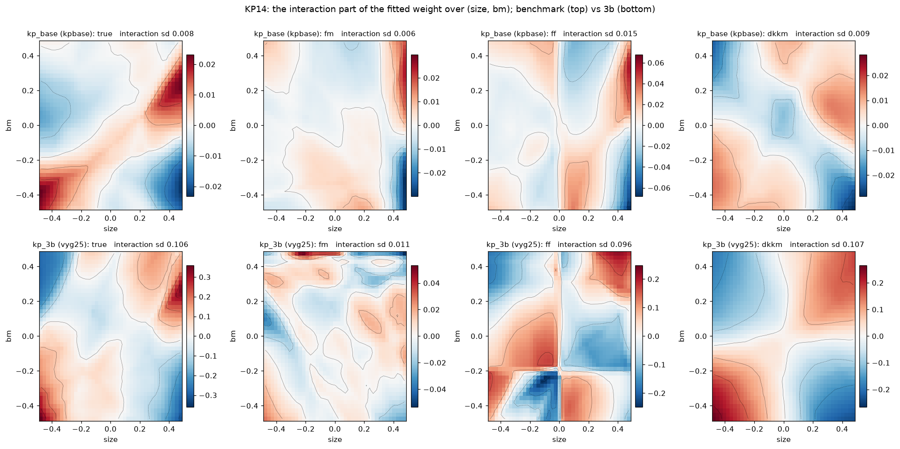
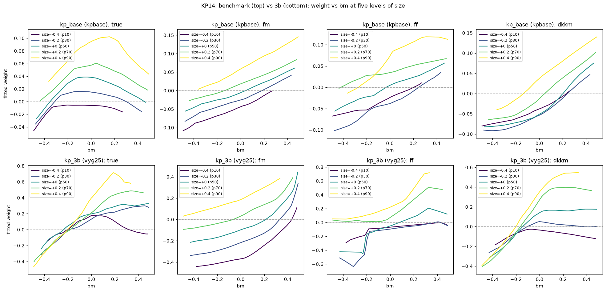
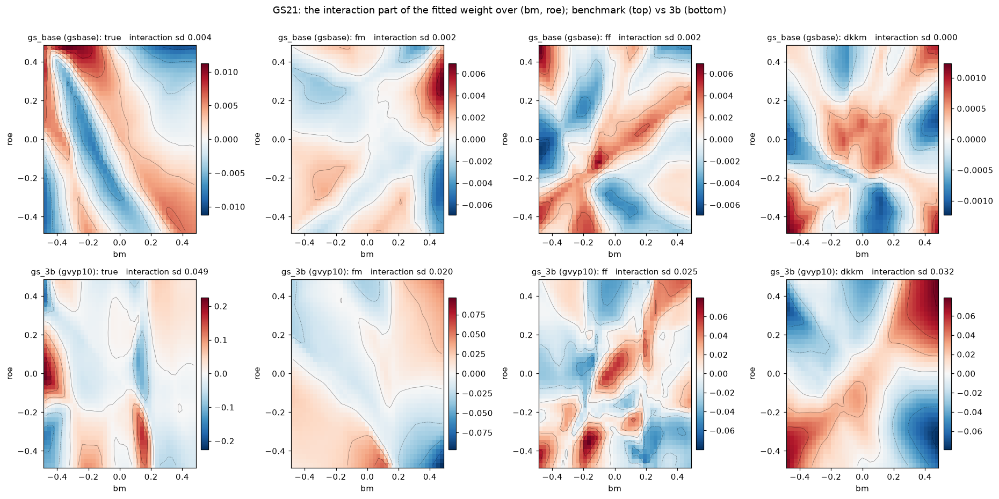
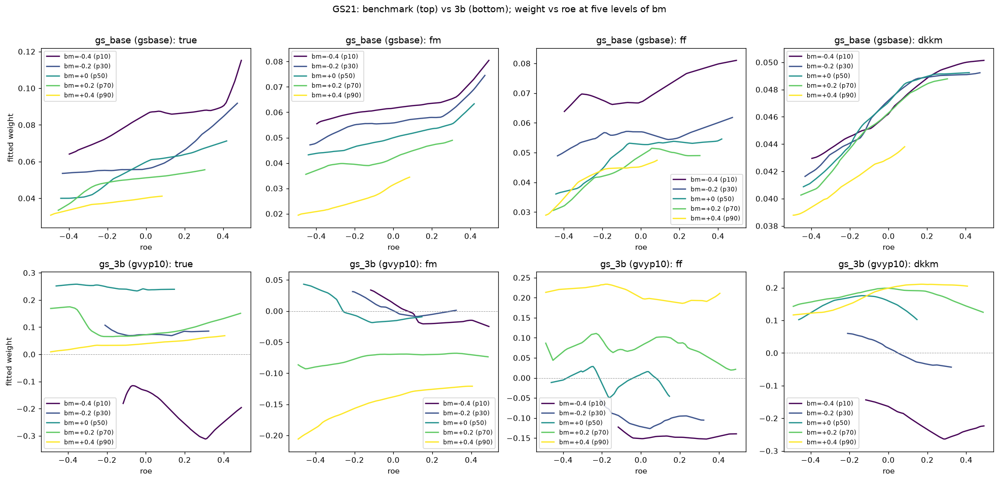
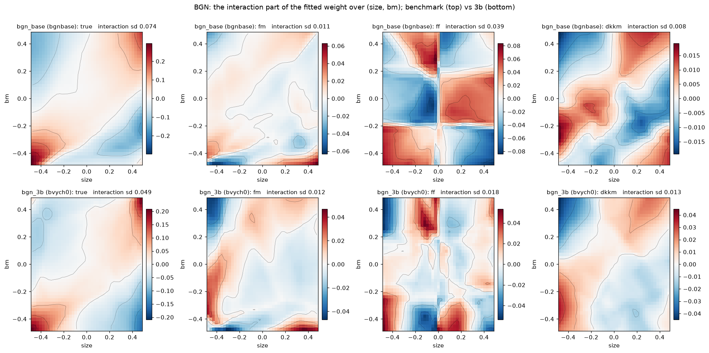
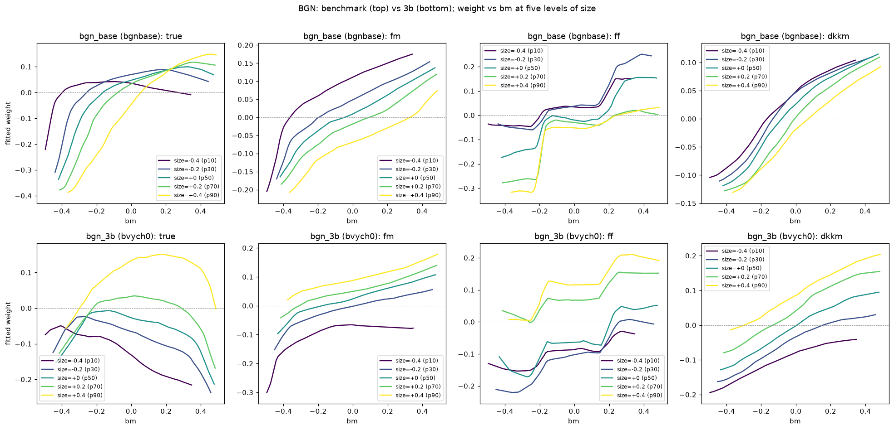

# What produces a capturable complexity gap: one representative economy per model and group

Alexander Ober with Claude, 2026-10-11, restructured 2026-10-15, final numbers 2026-10-24. Covers every economy with a protocol run (the
committed record in `variants/results/economy_table.csv` plus the 2026-10-06 to 2026-10-15 Quest campaign in
`/kellogg/proj/axa3203/bop_runs/results`) and the reduced-form screens. The main tables hold one representative
per model per group, built so that the same change is made in all three models; everything else that was run is in
the appendix. The tables are generated by `variants/campaign_tables.py` from the oracle and estimator files. Every campaign economy ran ten seeds (`gvypk3` twenty; the reduced form five per cell).

**Reading the tables.** Every table has the same columns. *SR_max*, the *linear ceiling* and the *room* are the
population investor's conditional Sharpe ratios over the evaluation window: the linear ceiling is the best Sharpe a
model linear in the ranks of the characteristics reaches with the true conditional moments, the room is the best
nonlinear ceiling (random features, bins, quadratic) minus that linear ceiling, and *room % lin* is the room as a
percentage of the linear ceiling. That is the theoretical scope for nonlinearity, before any estimation. Sharpe ratios add in quadrature, so the room understates an interaction that sits on a large linear base; *interaction SR* is the nonlinear ceiling's Sharpe orthogonal to the linear one, sqrt(nl² - lin²), the size of the interaction itself, and *DKKM ⊥* is DKKM's Sharpe orthogonal to the best classical method, signed like the gap. *Market %*
is the equal-weighted market's share of SR_max. *DKKM*, *FMR* (Fama-MacBeth), *FF* (Fama-French factors), *linear*
(the best of rank and level regressions, with and without the market) and *CAPM* (the estimated market line) are
each method's out-of-sample Sharpe at the 360-month window. All Sharpe ratios are monthly (multiply by sqrt(12) for annual), so a gap of 0.01 is 0.035 a year. The *fair gap* is DKKM minus the best of the four
classical methods, averaged across seeds, with in parentheses its t-statistic (the mean over its standard error
across seeds; ten seeds unless stated); *+* counts the seeds in which it is positive. A dagger marks an oracle
that predates the evaluation-window ceilings.

## The answer

Each model has a spine: its published baseline, and one economy in which a priced state y enters firm cash flows
through an interaction of two firm variables (group 3b). Every other group is one change to that spine, the same
change in all three models. Only the interaction produces a fair gap. With one type, every firm's exposure varies
with one firm variable (3a), the premium is monotone in one characteristic's rank, and room is 5 to 10% of the
linear ceiling with no gap; a crash-only factor (1) gives room of 3 to 12% and no gap; a quadratic price of the
model's own risk (2) gives room of 0 to 14% and no gap; the interaction economies (3b) have room of 16 to 47% and
gaps of +0.008 to +0.020 (t 2.7 to 5.2); with the type loading's cross-sectional mean set to zero (`vyg25s`,
`bvychs`, section 3b) room rises to 226% (KP14) and 20% (BGN) of the linear ceiling and the gap to +0.181 and
+0.026, while GS21's mirrored ladder (`gvy25s`) gains room (2% to 11%) and no gap (-0.012). In KP14 the strength of the level compensation changes only the
characteristics, and room and gap hold across it (fair gap +0.14 to +0.19 at bv_comp 0.6 to 1.8); weakening it in BGN, or
fixing GS21's capital structure (`gvytls`), lowers room and leaves no gap. Spreading vyg25s's mean-zero loading over K = 3 or 6 priced states (`vym3s`, `vym6s`, section 4)
keeps the linear ceiling at 0.19 and lowers the nonlinear one, so room falls to 110% and the gap to +0.10 (ten of ten
seeds at either K; K = 3 and K = 6 are identical to the third digit); a price of risk that switches sign with the state
(`kpsgn`) and six unsigned states (`vym6`) give nothing. More priced
factors (4) help only where each factor carries its own
interaction: in the reduced form, factors that load on products of partly hidden states give room and a gap that
rise with the number of factors and with the noise hiding the states, to +0.29 at ten factors, while factors that
load linearly on observed characteristics give nothing at any K. The structural two-state economies (appendix) add
no interaction: a second state through the same channel dilutes the exposure factor (KP14's room falls from 24% to
15%), and the designs that raise BGN's and GS21's gaps do so by giving each type its own state's premium, time
variation in a sort rather than a second product.

The weight analysis (section 5) shows the mechanism directly. In the 3b economies the true weight's slope in
book-to-market depends on size (KP14, BGN) or on profitability (GS21); DKKM's fitted weight surface bends the same
way, its nonlinear part correlating 0.77, 0.84 and 0.49 with the truth's, and in KP14 the interaction it recovers
has the truth's size (0.107 against 0.106); Fama-MacBeth's surface is parallel lines by construction; and in the
benchmarks there is no bend to find.

Economically: every factor model is firm exposure times aggregate shock, so the interaction that matters is not
with the aggregate state but within the exposure. A capturable gap needs a firm's exposure to a priced shock to be
the product of two things that different characteristics reveal, "what the firm is exposed to" (its type, or its
productivity) times "how levered the firm's claim is to it" (growth options in KP14, the project portfolio in BGN,
the coupon in GS21). What no linear portfolio holds is the part of the exposure orthogonal to every linear function of the
characteristics, and with one priced factor that is all or nothing: a linear portfolio with any covariance with the
exposure mimics the factor and takes its whole Sharpe (the reduced form's sign ladder, section 3b). A type loading
with a nonzero mean gives a sort that covariance, through the level compensation and the claim's leverage. That is
why every positive-ladder structural gap is modest; why the GS21 economy in which leverage acts through the equity
claim carries an interaction as large as KP14's (interaction SR 0.33) yet a near-zero gap, on a linear base of 0.81
(section 3b); and why the imposed GS21 product (productivity times coupon, mean zero), the reduced form's latent
products, and KP14's mirrored type ladder (`vyg25s`: loadings ±0.02 to ±0.14, mean zero) reach gaps of +0.02 to +0.3, +0.18 in
vyg25s: the linear span has nothing of theirs to hold. In vyg25s that is not because the type is hidden. The ranks of
size and book-to-market explain 90% of b_f in every seed (section 3b); what no linear function of those ranks holds is
a premium that is hump-shaped in b_f, highest for the two smallest loadings and lowest at both ends, in ten of ten
seeds. In BGN's and GS21's mirrored ladders the type is as visible and the premium is monotone in it, so a linear
sort takes it and room stays small.

| group | the one change to the spine | room % of linear | fair gap |
|---|---|---|---|
| 1. distribution of shocks | a crash-only cash-flow factor | 3-12 | none |
| 2. price of risk | quadratic in the model's own state | 0-14 | none |
| 3a. single-characteristic exposure | one type exposed to y | 5-10 | none |
| 3b. interaction | three types (a product in GS21) exposed to y | 16-47 | +0.008 to +0.020 |
| 3b with a mean-zero type loading | the ladder mirrored, six types, level-compensated | 20 (BGN) / 226 (KP14) | +0.026 / +0.181 |
| the mean-zero ladder at other compensation strengths | bv_comp 0.6 / 1.8 (KP14); 0.4 to 0.8 (BGN) | 147 / 167 (KP14); 7-12 (BGN) | +0.142 / +0.185; none |
| the mean-zero loading over K = 3 / 6 priced states (KP14) | the signed ladder spread over K states, 24 mean-zero types | 110 / 110 | +0.100 / +0.099 |
| 4. larger factor model (reduced form) | K factors loading linearly on characteristics / on products of latent states | 0-1 / 190-660 | none / +0.03 to +0.29 |
| structural second priced state (appendix) | a second chain in each model | 15-65 | +0.005 to +0.056 |

The baselines every group is read against:

<!-- TABLE:g0 -->
| model | economy | SR_max | market % | linear ceiling | room | room % lin | interaction SR | DKKM | FMR | FF | linear | CAPM | fair gap | DKKM ⊥ | + |
|---|---|---|---|---|---|---|---|---|---|---|---|---|---|---|---|
| BGN | `bgnbase` -- baseline, no priced state beyond the rate | 0.301 | 54% | 0.250 | +0.027 | 11 | 0.12 | 0.238 | 0.213 | 0.208 | 0.238 | 0.162 | -0.0001 (t -0.0) | +0.00 | 6/10 |
| GS21 | `gsbase` -- baseline | 0.293 | 95% | 0.291 | +0.001 | 0 | 0.03 | 0.283 | 0.260 | 0.258 | 0.286 | 0.278 | -0.0028 (t -4.3) | -0.03 | 2/10 |
| KP14 | `kpbase` -- baseline, one type, no priced state | 0.229 | 35% | 0.221 | +0.004 | 2 | 0.04 | 0.208 | 0.193 | 0.195 | 0.209 | 0.078 | -0.0010 (t -0.6) | -0.00 | 6/10 |
<!-- /TABLE:g0 -->

## 1. A different distribution of shocks: a crash-only factor

A cash-flow factor y (unit variance, half-life two years) multiplies every firm's cash flows as e^{b y}, with one
exposure b per model: 0.035 in BGN's project cash flows, 0.10 x standardized productivity in GS21's output (the product
economy's exposure without the coupon), 0.07 in KP14's project cash flows.
Its Gaussian shocks carry no price. Its only priced event is a crash: each month, with probability 1%, y jumps to
-3.5 standard deviations, and the kernel weights that transition by e^2 (about 7% a month risk-neutral); y then
recovers at its ordinary mean reversion. Against the single-type economy of group 3a, the only change is that the
Gaussian price is replaced by the crash.

<!-- TABLE:g1 -->
| model | economy | SR_max | market % | linear ceiling | room | room % lin | interaction SR | DKKM | FMR | FF | linear | CAPM | fair gap | DKKM ⊥ | + |
|---|---|---|---|---|---|---|---|---|---|---|---|---|---|---|---|
| BGN | `bvy1j` -- crash-only factor: e^0.035y, the same crash | 0.324 | 50% | 0.278 | +0.033 | 12 | 0.14 | 0.265 | 0.239 | 0.235 | 0.262 | 0.160 | +0.0003 (t 0.1) | +0.01 | 6/10 |
| GS21 | `gvyz10j` -- crash-only factor on 0.10 z y: y unpriced except the 1%/month jump to -3.5 (weight e^2) | 0.386 | 82% | 0.374 | +0.011 | 3 | 0.09 | 0.358 | 0.340 | 0.333 | 0.362 | 0.316 | -0.0046 (t -3.5) | -0.05 | 1/10 |
| KP14 | `vy1j` -- crash-only factor: e^0.07y, y unpriced except a 1%/month jump to -3.5 (weight e^2) | 0.336 | 21% | 0.277 | +0.012 | 4 | 0.08 | 0.259 | 0.241 | 0.249 | 0.265 | 0.066 | -0.0057 (t -2.3) | -0.04 | 2/10 |
<!-- /TABLE:g1 -->

Verdict: a crash changes the distribution of a shock every firm bears in the same proportion. The cross-section of
premia it creates is a sort on the one firm state that scales the exposure, so the linear ceiling takes nearly all
of it: room is 12% of the linear ceiling in BGN, 3% in GS21 and 4% in KP14, and the fair gap is zero or negative in
all three (+0.000, -0.005, -0.006). Adding the same
crash to the interaction economies instead (appendix A1) leaves their room and gap at the control's in BGN and
GS21 and halves KP14's.

## 2. A different price of risk: quadratic in the model's own state

The price of each model's own aggregate risk is multiplied by 1 + 0.25 s^2, capped at 3, where s is a standardized
aggregate state: GS21's productivity x, and for KP14, whose own states are random walks, an unpriced stationary
state y that no firm is exposed to. The multiplier never falls below 1 because KP14's growth-option discount turns
negative once the price of x-risk drops below about 0.82 of its value. In BGN the price of the market shock sigma_z
is multiplied by the same function of the standardized rate, binned to seven equiprobable levels of the rate (1.00,
1.03, 1.17 and 1.68 from the middle outward) so that project values keep a closed form; the date-k cash flow is
priced at the bin of the rate one period before it pays.

<!-- TABLE:g2 -->
| model | economy | SR_max | market % | linear ceiling | room | room % lin | interaction SR | DKKM | FMR | FF | linear | CAPM | fair gap | DKKM ⊥ | + |
|---|---|---|---|---|---|---|---|---|---|---|---|---|---|---|---|
| BGN | `bq25` -- sigma_z x min(1 + 0.25 s^2, 3), s the standardized rate, 7 bins | 0.411 | 36% | 0.346 | +0.049 | 15 | 0.18 | 0.339 | 0.303 | 0.293 | 0.335 | 0.149 | +0.0034 (t 0.7) | +0.00 | 4/10 |
| GS21 | `gq25` -- gamma_x x min(1 + 0.25 x^2, 3) | 0.345 | 95% | 0.343 | +0.002 | 0 | 0.03 | 0.334 | 0.316 | 0.309 | 0.337 | 0.326 | -0.0036 (t -5.5) | -0.05 | 0/10 |
| KP14 | `kpq` -- gamma_x x min(1 + 0.25 y^2, 3), y unpriced | 0.260 | 53% | 0.251 | +0.003 | 1 | 0.04 | 0.240 | 0.226 | 0.225 | 0.242 | 0.137 | -0.0021 (t -1.5) | -0.02 | 4/10 |
<!-- /TABLE:g2 -->

Verdict: a price of risk that moves with the aggregate state rotates the premium across states and leaves it
linear in the ranks within one. The quadratic price gives room under 1% of the linear ceiling in GS21 and KP14,
and 14% in BGN, where the rate is itself a priced state so a price that rises with its distance from the mean
rotates the premium with it; the fair gap is zero in all three (+0.003, -0.004, -0.002). The regime prices tried
earlier (appendix) do the same, and BGN's fast regime gave the group's one small positive number (+0.008), which a
ranks-times-state linear benchmark takes.

## 3. Different exposures to aggregate risk

### 3a. Exposure that a single characteristic captures

The priced state y is added with one type: every firm's cash flows load on it with the same exponent (the group 1
exposures, now with y's Gaussian shocks priced at 2.5). A firm's exposure to y then varies across firms only
through one firm state: the mix of assets in place and growth option in BGN, productivity in GS21 (the product
economy's exposure without the coupon), the growth-option share in KP14.

<!-- TABLE:g3a -->
| model | economy | SR_max | market % | linear ceiling | room | room % lin | interaction SR | DKKM | FMR | FF | linear | CAPM | fair gap | DKKM ⊥ | + |
|---|---|---|---|---|---|---|---|---|---|---|---|---|---|---|---|
| BGN | `bvy1ch` -- one type, project cash flows x e^0.035y | 0.336 | 54% | 0.297 | +0.029 | 10 | 0.13 | 0.283 | 0.252 | 0.255 | 0.281 | 0.181 | +0.0017 (t 0.8) | +0.02 | 7/10 |
| GS21 | `gvyz10` -- one type, output x e^0.10 z y: the product economy without the coupon | 0.854 | 50% | 0.800 | +0.043 | 5 | 0.27 | 0.793 | 0.805 | 0.742 | 0.808 | 0.421 | -0.0164 (t -6.5) | -0.15 | 1/10 |
| KP14 | `vy1` -- one type, cash flows x e^0.07y | 0.466 | 12% | 0.369 | +0.019 | 5 | 0.12 | 0.355 | 0.335 | 0.340 | 0.360 | 0.047 | -0.0050 (t -2.9) | -0.05 | 1/10 |
<!-- /TABLE:g3a -->

Verdict: a monotone function of one firm state, however nonlinear, is linear in the rank of the characteristic
that reveals it. Room is 10% of the linear ceiling in BGN and 5% in GS21 and KP14, and the fair gap is zero or
negative in all three (+0.002, -0.017, -0.005); in GS21 the productivity exposure alone carries a large premium
(SR_max 0.85) that the linear ceiling captures almost entirely. The same holds for every other single-characteristic wiring tried (appendix A3), including
ones with far more room: room is necessary, not sufficient. The absence of room is not an artefact of the rank standardization DKKM applies to its random features after the
sines and cosines: recomputing the ceilings on the saved panels with the raw features (two seeds per economy,
`variants/mlp/room_raw.py`) gives room of 4% / 6% / 8% of the linear ceiling in `vy1` / `gvyz10` / `bvy1ch` against
5% / 6% / 8% with the standardization, and 19% / 62% / 10% against 26% / 61% / 11% in the 3b economies; the quadratic
and bin ceilings, which never standardize, say the same.

### 3b. Exposure as an interaction of several characteristics

The same y with heterogeneity in what is exposed to it: three types of firms with exposures 0.01 / 0.035 / 0.07
(BGN) and 0.02 / 0.07 / 0.14 (KP14), level-compensated so that value at y = 0 does not reveal the type; and in GS21,
where types never produced room (appendix A3), the product of standardized productivity and the standardized coupon
written into the production function with coefficient 0.10. Exposure is then a product: type x project mix (BGN),
type x growth-option share (KP14), productivity x leverage (GS21), each factor revealed by a different
characteristic.

<!-- TABLE:g3b -->
| model | economy | SR_max | market % | linear ceiling | room | room % lin | interaction SR | DKKM | FMR | FF | linear | CAPM | fair gap | DKKM ⊥ | + |
|---|---|---|---|---|---|---|---|---|---|---|---|---|---|---|---|
| BGN | `bvych0` -- y as a 21-node chain, three types (control) | 0.576 | 37% | 0.341 | +0.055 | 16 | 0.20 | 0.334 | 0.285 | 0.292 | 0.326 | 0.216 | +0.0076 (t 2.7) | +0.05 | 8/10 |
| GS21 | `gvyp10` -- product exposure zb at 0.10 (control) | 0.650 | 8% | 0.447 | +0.194 | 47 | 0.46 | 0.553 | 0.238 | 0.333 | 0.548 | 0.018 | +0.0057 (t 0.7) | +0.01 | 5/10 |
| KP14 | `vyg25` -- three types on y, price 2.5 (control) | 0.495 | 11% | 0.346 | +0.082 | 24 | 0.25 | 0.350 | 0.292 | 0.320 | 0.335 | 0.044 | +0.0148 (t 5.2) | +0.09 | 10/10 |
<!-- /TABLE:g3b -->

Verdict: every interaction economy has a positive mean gap with most seeds positive (t of 2.7 to 5.1 across seeds),
at room of 16 to 47% of the linear ceiling. The gaps are statistically clear and economically modest: 2 to 4% of
the linear Sharpe at these three representatives; the scaled GS21 versions in the appendix reach 11 to 22%. The premium is multiplicatively separable in the ranks, f(A) x g(B); a linear model in the ranks
fits only additive functions, random features span products, and DKKM recovers 15 to 30% of the room as a gap.
Going from 3a to 3b changes nothing but the second dimension of heterogeneity, and that is what creates the gap.
The GS21 product ladder (appendix A4) shows the room hump-shaped in the product's size and the gap rising to +0.08. The GS21 product is imposed: the coupon multiplies the exposure inside the production function. Its
structural counterpart, where the exposure 0.10 z̃ y sits in cash flows and leverage acts only through the equity
claim, was tested by fixing each firm's capital structure as a type drawn independently of productivity (`gvyzlf`:
coupons 0.16, 0.42 and 0.68 per unit capital, debt-to-equity 0.25 to 3.25, no refinancing; four variants in the
appendix). The interaction is there, the true premium's slope in leverage flips sign across profitability quintiles,
but the equity claim amplifies the y premium by only 20 to 40% around a large additive productivity part, so room
stays at 6 to 8% of the linear ceiling and the gap at +0.005 (t 1.8). The imposed product has no additive part, which is where its 43% comes from. Three levers on `gvyzlf` fail to change this (appendix). Valuing the debt as riskless (`gvyzlr`) leaves
every number unchanged, so the debt was not absorbing y risk; a more persistent y (`gvyzlp`, κ_y 0.10) halves SR_max
and the interaction with it; and cutting the price of the aggregate productivity shock from 0.5 to 0.1 (`gvyzlg`,
with its own benchmark `gsbg1` and 3a comparator `gvyz10g`) lowers the market's share from 50% to 27% but leaves the
linear ceiling at 0.72, because the base is the priced productivity level itself rather than the market: room 9%,
gap -0.006. The interaction's own Sharpe is 0.31 to 0.33 in all of them, the size seen in KP14's and BGN's 3b economies (table column *interaction SR*); what differs is the base it sits on. Two further wirings close the question from the other side: fixing the product's sign with a leverage-level term (`gvyp10c`, exposure 0.10 b̃ (z̃ + 2)) hands the market a large negative premium and leaves room of 1%, and KP14's own recipe, three latent exposure types times three fixed leverage types (`gvytl`, and `gvytlg` at a fifth of the aggregate shock's price), gives the market 72 to 84% of the attainable Sharpe and room of 1 to 3%. Every exposure with a nonzero cross-sectional mean is carried by GS21's equal-weighted market; the product is the one wiring whose mean is zero, which is why it alone has room.

**The sign of the type loading.** The dispersion bound in the summary is not what sets room, and the reduced form said so
before the structural runs did. With one priced factor and N = 500, any linear-in-characteristics portfolio whose
covariance with the exposure is not zero mimics the factor and diversifies the rest, so it takes the factor's whole
Sharpe: room is all or nothing, and it is all only when the exposure is orthogonal to every linear function of the
characteristics. The sign ladder of the reduced form (appendix, `lsh` rows) shows this directly: a product of two
mean-zero latent states has room of +0.39 to +0.42, and shifting either factor's mean by one standard deviation, or
more, or replacing the product by a one-signed ratio (`lrt`), sends room to 0.000 to 0.005 at the same SR_max. In
the structural models the type loading's cross-sectional mean is that shift. Mirroring vyg25's ladder to six types
of equal share with loadings ±0.02, ±0.07, ±0.14 (`vyg25s`, level-compensated as vyg25, price 2.5) raises KP14's
room from +0.082 to +0.349, two and a quarter times a linear ceiling that falls from 0.346 to 0.174 (a mean-zero
type leaves no b̄ × growth-option piece for a book-to-market sort to hold), SR_max from 0.495 to 0.575, and DKKM's
fair gap from +0.015 to +0.181 (t 17, ten of ten seeds; DKKM 0.373 against FMR's 0.102 and the linear model's
0.153). The market's share stays at 11%. BGN moves the same way but less far: `bvychs` (bvych0's ladder mirrored,
±0.01, ±0.035, ±0.07, level-compensated) has room of 20% of the linear ceiling against 16% and a fair gap of
+0.026 (t 4.9, nine of ten) against +0.008, with the linear ceiling unchanged (0.341 to 0.349) and SR_max lower
(0.576 to 0.510). Why BGN's linear ceiling holds where KP14's halves is measured directly. The type draws are reconstructed from the
simulators' seeds (`variants/type_visibility.py`; the reconstruction is checked by the monotone mean value by
type) and each type's mean return and mean characteristics are read off the panels. The level compensation hides
none of the ladders. In `vyg25s` the within-month ranks of the five characteristics explain 88 to 92% of b_f in
every seed (correlations: size +0.88, book-to-market -0.82; mean value rises fifty-fold from the most negative to
the most positive loading, θ_f 1 to 3.36), in `bvychs` 46 to 70% (size +0.75), in `gvy25s` 83 to 87% (ROE +0.69,
size +0.59, book-to-market -0.53, leverage -0.15). What differs is the shape of the premium in the type. In BGN and
GS21 the mean return rises monotonically in b_f in ten of ten seeds (seed 0: bvychs 0.28 to 1.25% a month, gvy25s
-0.22 to +0.97%), so a sort on the characteristics that reveal b_f holds the premium and the linear ceiling keeps
it. In vyg25s the mean return is hump-shaped in b_f in ten of ten seeds (seed 0: 0.56, 0.75, 0.86, 0.86, 0.83,
0.75% a month from b_f = -0.14 to +0.14); the reading this suggests is that the compensation changes each type's
growth-option leverage and with it the premium on the model's other risks, so the two smallest loadings earn the
most and both ends the least. A linear function of ranks that are monotone in b_f cannot be high in the middle and
low at both ends; a quadratic in size can, and that non-monotone piece is the room DKKM takes 71% of. The sign of
the loading matters because it makes the premium non-monotone in a visible characteristic, not because it hides
the type. `vyg25u`, vyg25 without the level compensation, has vyg25's returns exactly (SR_max 0.495 to every digit;
only the characteristics change): its premium is monotone in b_f (0.85, 0.81, 0.75% a month), the type is less
visible than with the compensation (R² 0.46 to 0.53 against 0.84 to 0.85: the compensation reveals the type
through size rather than hiding it), and it loses the gap (-0.002, t -0.5, three of ten) and a fifth of the room.
`bvysg`, the earlier BGN signed ladder without compensation, has a negative gap where `bvychs` has a positive one.
The capturable gap is then the Sharpe of the part of the expected return that no linear function of the
characteristics spans, not a dispersion ratio. GS21 does not follow. `gvy25s`, gvy25's three level types mirrored to six of equal share with
b_f ∈ {±0.015, ±0.05, ±0.10}, level-compensated (bv_comp 1.2) at the same price, raises GS21's room from +0.014 to
+0.062 (2% to 11% of the linear ceiling) and halves the market's share of SR_max (84% to 50%), but the linear ceiling
keeps 88% of SR_max (0.558 of 0.632, against 0.684 of 0.739 in gvy25), and DKKM does not take what is left: the fair
gap is -0.012 (t -4.4, two of ten seeds positive; DKKM 0.549 against FMR's 0.541 and the fair linear model's 0.561),
where the prediction was +0.02 to +0.06. The visibility numbers explain it: the type shows in
ROE, size and book-to-market, the premium is monotone in the type, and the linear span holds most of the exposure.
The earlier conjecture that the firm's chosen leverage reveals the sign is not supported (leverage rank correlates
-0.15 with b_f); the order of the three rooms (226%, 20%, 11%) is the order of how non-monotone the premium is in the
type, not of how much the firm decides.

**The strength of the level compensation.** Two ladders test whether the compensation, which sets how visible the
type is, moves room. In KP14 it changes the characteristics and nothing else: `vyg25s6` and `vyg25s18` (bv_comp 0.6
and 1.8) have vyg25s's returns exactly, seed by seed (SR_max and every type's mean return agree to the digit). The
type's visibility moves a lot: R² of b_f on the ranks is 0.67 to 0.74 at 0.6 (through book-to-market; size is
uncorrelated with b_f), 0.88 to 0.92 at 1.2 and 0.95 to 0.97 at 1.8 (size correlation 0.97). The linear ceiling
barely moves (0.21, 0.17, 0.21), room is 147%, 226% and 167% of it, and the fair gap is +0.142 (t 24), +0.181 and
+0.185 (t 8.7), five of five seeds at both new points (seven and five oracle seeds, five estimator seeds each). The
premium stays hump-shaped in b_f because the returns do not change, and the hump is the room; how visible the type
is does not matter. In BGN the compensation does change returns, and weakening it goes the other way: `bvychs4`,
`bvychs6` and `bvychs8` (bv_comp 0.4, 0.6, 0.8) make the type more visible (R² 0.89 at 0.4 and 0.76 at 0.8, through
size) with the premium monotone in b_f, room falls from 20% to 12%, 8% and 7% of a linear ceiling that rises from
0.35 to 0.52 to 0.59, and the fair gap is -0.004, +0.001 and +0.009, none distinguishable from zero (five, three and
three seeds; the rest were stopped at the oracle). The spec's prediction, a hidden sign near 0.6 lifting room above
50%, is falsified.

**GS21 with its capital structure fixed.** `gvytls` takes `gvytl`'s chassis (three coupons, 0.15 / 0.40 / 0.70 per
unit capital, fixed for life and drawn independently of the type) and mirrors the exposure ladder as `gvy25s` does:
eighteen mean-zero types. It tests whether the firm's coupon choice is what reveals the sign in GS21. It is not: room
is 8% of the linear ceiling (eight oracle seeds) against gvy25s's 11%, and the fair gap is -0.007 (t -1.0, one of
three; the other seven were stopped). The type stays visible (R² 0.83 to 0.84; ROE +0.68, size +0.67, book-to-market
-0.63), and within each coupon the mean return rises with b_f. The most exposed levered firms also select themselves
out: in each of three seeds none of the b_f = -0.10, coupon-0.70 firms and at most five of about thirty b_f = -0.05,
coupon-0.70 firms survive into the panel. The prediction (room 15 to 25%) is falsified.

**A hump outside KP14, and larger loadings.** The decomposition of each type's premium on the market and on y
(`variants/hump_decomp.py`: a type's equal-weighted return regressed on the equal-weighted market and on dy) says why
only KP14's premium is hump-shaped. In `vyg25s` the market beta rises from 0.71 to 1.27 across the ladder, concave in
b_f, while the residual premium falls from +0.10 to -0.23% a month: two opposed channels, and their sum peaks inside.
In `bvychs` both channels rise with b_f; in `gvy25s` they oppose, but the y channel is ten times the market channel.
Seven economies tried to build the second channel into BGN and GS21, and none did. A pure curvature of the
productivity loading in GS21 without y (`gxq35`, `gxq70`: loading 1 + c (z̃² − 1)/√2, c = −0.35 and −0.70) gives
room of 1 to 3% and a gap of zero. Keeping `gvy25s`'s level shifts but cutting the y price (`gvy25sq`, `gvy25sh`:
γ_v 0.25 and 0.5 with bv_comp 12 and 9) does make the premium non-monotone, because the market beta collapses from
1.0 to 0.5 at the top of the ladder, but the premium then spans 0.0 to 0.4% a month against −0.2 to +1.0 in
`gvy25s`, room is 1 to 3% and the gap −0.004 and −0.008. In BGN the compensation ladder was continued in both
directions (`bvychsn5`, `bvychs18`, `bvychs25`, `bvychs30`, `bvychs35`: bv_comp −0.5, 1.8, 2.5, 3.0, 3.5). The
premium stays monotone in b_f at every rung (bvychs25 seed 0: 0.27 to 1.17% a month), so no hump; but room, which was
20% of the linear ceiling at 1.2 and 27% at 1.8, is 67% at 2.5 (+0.163), 67% at 3.0 (+0.182) and 66% at 3.5
(+0.185, seven oracle seeds), with SR_max rising from 0.51 to 0.50 at 3.5 and the linear ceiling falling from 0.35
to 0.25 to 0.29. It is cross-sectional nonlinearity, not conditioning: the bins basis alone reaches 0.36 against a
linear 0.21 in bvychs25's seed 0. DKKM takes some of it: the fair gap is +0.048 (t 3.7, nine of ten) at 2.5 and
+0.063 (t 5.6, ten of ten) at 3.0, the largest BGN gaps of the campaign (bvychs +0.026; bvychs35's estimators were
still running when this was written), where 1.8 gave +0.006 (t 1.4) and −0.5 gave −0.005 despite 35% room. The
response to bv_comp is not monotone, and the oracle room at −0.5 was not learnable: DKKM there is below the linear
model in four of ten seeds.

**Non-monotone exposures in BGN and GS21.** Two constructions put the non-monotonicity into the exposure itself
rather than hoping for it in the premium. `bvyvee` gives BGN five types on a visible level ladder (θ_f = 0.6, 0.8,
1.0, 1.2, 1.4 multiplies the cash-flow level) with the exposure V-shaped across it (b_f = +0.07, 0, −0.07, 0, +0.07),
so the extremes of size are the exposed firms. Room is 23% of the linear ceiling (bvychs 20%) and the fair gap +0.007
(t 1.3, six of eight): the premium is monotone in the level itself, from −0.15 to +1.0% a month along the ladder with
the market beta rising from 0.5 to 1.2, because in BGN the level changes returns and that monotone piece swamps the V
in b_f. The mirror (`bvyhump`) was solved and not run. In GS21 the y exposure was written as a quadratic in the
firm's own standardized coupon, c (b̃² − 1), with c = +0.1, +0.2 and −0.1 (`gvyql10`, `gvyql20`, `gvyqh10`), so that
extreme leverage is more (or less) exposed to cash-flow risk. Room is 1 to 11%, the fair gaps −0.002, −0.002 and
−0.026 (none of three seeds positive in any), and two things explain it: the leverage characteristic spans only
0.002 to 0.006 across quintiles in these panels, so the term has almost no cross-sectional variation to load on
(the premium across leverage quintiles is within ±0.09% a month of its market part), and the one-type wiring hands
the market a negative premium (−0.1 to −0.7% a month, `market %` negative in the appendix table).

**The size of the loading.** The one lever that moved the gap was the size of the sign-switching loading, and only
in KP14. `vyg25sx2` doubles `vyg25s`'s loadings (±0.04, ±0.14, ±0.28; θ_f 1 to 11.2, the compensation still exact at
y = 0). SR_max rises from 0.575 to 0.640, the linear ceiling falls from 0.174 to 0.158, room is +0.437 (343% of the
ceiling against 226%), and the fair gap +0.245 (t 11.1, ten of ten; DKKM 0.456 against the linear model's 0.134 and
FMR's 0.206) against +0.181. The hump deepens: seed 4's premium is −0.04, +0.43, +0.60, +0.58, +0.43, +0.32% a month
from b_f = −0.28 to +0.28, the residual channel +0.25 to −0.27 against a market beta of 0.58 to 1.36. Tripling
(`vyg25sx3`: ±0.06, ±0.21, ±0.42; θ_f 1 to 37) is past the peak: the forty-fold level spread begins to show
linearly in size, the linear ceiling rises to 0.248, room is +0.364 (175%) and the gap +0.218 (t 9.7, ten of ten).
BGN and GS21 do not follow. `bvychsx2` and `bvychsx3` (loadings ×2 and ×3) raise room from +0.068 to +0.089 and
+0.081 but the gaps are +0.007 (seven of ten) and +0.002 (six of ten); the room is there and DKKM does not find it.
`gvy25sx2` makes the type linearly visible, as the product ladder did: the linear ceiling is 0.72 of an SR_max of
0.82, room 13%, gap +0.0005. (`gvy25sx3`'s b_f = +0.045 type did not converge and the economy was not run.)

## 4. Larger factor models

More priced factors are tested where the structure is controlled: the reduced form below adds K priced factors to a
market factor, with the total price of risk held across K, and varies only whether the factors load linearly on the
observed characteristics or on products of partly hidden states (setup in section 6). The structural version, a second
priced state in each of the three models, is in the appendix (table 9).

<!-- TABLE:rf -->
| configuration | SR_max | market % | linear ceiling | room | room % lin | interaction SR | DKKM | FMR | FF | linear | CAPM | fair gap | + |
|---|---|---|---|---|---|---|---|---|---|---|---|---|---|
| kfh_lin_1 -- K=1 factor on observed characteristics, linear loadings | 0.598 | 8 | 0.598 | +0.000 | 0 | 0.01 | 0.590 | 0.584 | 0.581 | 0.595 | 0.041 | -0.0067 (t -1.7) | 0/5 |
| kfh_lin_4 -- K=4 | 0.592 | 8 | 0.588 | +0.003 | 0 | 0.06 | 0.555 | 0.578 | 0.567 | 0.575 | 0.041 | -0.0237 (t -3.1) | 0/5 |
| kfh_lin_16 -- K=16 | 0.385 | 13 | 0.383 | +0.001 | 0 | 0.03 | 0.352 | 0.357 | 0.353 | 0.365 | 0.041 | -0.0128 (t -1.2) | 2/5 |
| lfh_L5_K1_n0 -- K=1 product of latent states, no observation noise | 0.598 | 8 | 0.208 | +0.389 | 187 | 0.56 | 0.570 | 0.156 | 0.539 | 0.175 | 0.041 | +0.0311 (t 4.0) | 5/5 |
| lfh_L5_K2_n0 -- K=2 | 0.598 | 8 | 0.144 | +0.453 | 314 | 0.58 | 0.564 | 0.111 | 0.520 | 0.115 | 0.041 | +0.0443 (t 6.7) | 5/5 |
| lfh_L5_K3_n0 -- K=3 | 0.598 | 8 | 0.106 | +0.490 | 464 | 0.59 | 0.566 | 0.059 | 0.507 | 0.084 | 0.041 | +0.0589 (t 9.0) | 5/5 |
| lfh_L5_K5_n0 -- K=5 | 0.598 | 8 | 0.092 | +0.502 | 549 | 0.59 | 0.543 | 0.048 | 0.423 | 0.064 | 0.041 | +0.1193 (t 21.6) | 5/5 |
| lfh_L5_K10_n0 -- K=10 | 0.598 | 8 | 0.089 | +0.503 | 568 | 0.58 | 0.507 | 0.047 | 0.250 | 0.067 | 0.041 | +0.2572 (t 39.9) | 5/5 |
| lfh_L5_K1_n1 -- K=1 product of latent states, observation noise 1.0 | 0.598 | 8 | 0.167 | +0.416 | 249 | 0.56 | 0.526 | 0.096 | 0.433 | 0.137 | 0.041 | +0.0930 (t 3.8) | 5/5 |
| lfh_L5_K2_n1 -- K=2 | 0.598 | 8 | 0.111 | +0.469 | 423 | 0.57 | 0.523 | 0.072 | 0.420 | 0.082 | 0.041 | +0.1025 (t 6.8) | 5/5 |
| lfh_L5_K3_n1 -- K=3 | 0.598 | 8 | 0.091 | +0.486 | 537 | 0.57 | 0.528 | 0.057 | 0.391 | 0.073 | 0.041 | +0.1371 (t 10.4) | 5/5 |
| lfh_L5_K5_n1 -- K=5 | 0.598 | 8 | 0.075 | +0.496 | 664 | 0.57 | 0.496 | 0.038 | 0.309 | 0.060 | 0.041 | +0.1866 (t 26.3) | 5/5 |
| lfh_L5_K10_n1 -- K=10 | 0.598 | 8 | 0.079 | +0.479 | 607 | 0.55 | 0.456 | 0.052 | 0.171 | 0.077 | 0.041 | +0.2854 (t 24.8) | 5/5 |
<!-- /TABLE:rf -->

Factors that load linearly on observed characteristics leave no room at any K and a negative gap; factors that load
on products of partly hidden states give room and a gap that grow monotonically with K and with the observation noise
that hides the states. Bounded and curvature loadings on observed characteristics are in the appendix (the RF rows of table 8).

**The structural version of the latent-product ladder: vyg25s's signed loading over K priced states** (`vym3s`,
`vym6s`; rows in the appendix table). y ∈ R^K, K independent OU states each priced 2.5/sqrt(K); 24 mean-zero types of equal share with loading vectors b_f ∈ R^K of magnitude 0.07 or 0.14 at cosines ±1, ±0.84, ±0.68, ±0.52, ±0.36, ±0.20
to the price vector (at K = 6 the off-price directions are orthogonal across types), level-compensated as vyg25s
(bv_comp 1.2). Both are vyg25s with its one mean-zero type spread over K states. The linear ceiling is unchanged (0.191
and 0.192 against 0.174), so the linear span holds no more of the premium than at K = 1, but the nonlinear ceiling falls from 0.523 to 0.415 and 0.418 and
SR_max from 0.575 to 0.503 and 0.507: a type whose loading is misaligned with the price vector carries the full y-risk
of its magnitude and earns only the cosine of the premium (the solver reduces each type to b_eff = ‖b_f‖ and
γ_eff = b_f·γ/‖b_f‖). Room is 0.224 and 0.225 (110% of the linear ceiling against 201%), and DKKM takes the same 71%
of the nonlinear ceiling as in vyg25s: 0.296 against FMR's 0.134 and the fair linear model's 0.196, a fair gap of
+0.100 (t 21) and +0.099 (t 15), ten of ten seeds at either K, the second largest of the campaign and half of
vyg25s's. K = 3 and K = 6 agree to the third digit, so beyond the alignment grid K enters only through the Gram
matrix of the loadings, and that does nothing: in the structural models, unlike the reduced form, more priced states
do not multiply interactions, because every state acts through the one growth-option elasticity. The prediction
(room rising with K past vyg25s's) was wrong on room. The unsigned construction at K = 6 (`vym6`: 24 rank-6 types,
cosines 0.20 to 1 times magnitudes 0.02 to 0.14) reproduces `vym3` (room 19%, fair gap +0.000, four of ten seeds,
against 19% and -0.003): the two (magnitude, cosine) grids are nearly the same, and K itself is not a lever.

The other two routes to a larger gap give nothing. A price of risk that switches sign with the state (`kpsgn`: kpgam's
wiring with g(y) = 2 logistic(-2y) - 1, so the price of x is +γ_x when y is low and -γ_x when it is high) is a
degenerate economy: the negative price in half the states inflates values and returns (idiosyncratic sd 0.62 against
kpgam's 0.10), SR_max is 0.14 against kpgam's 0.36, and its room, 74% of a linear ceiling of 0.07, is conditioning
room (a linear benchmark with constant weights reaches 0.03 at the oracle, with the state 0.13), on which DKKM's fair
gap is -0.004 (three seeds; the other seven were stopped after their oracles put SR_max at 0.14 to 0.19). The BGN version (`bgsgn`, the regime price of the market
shock at -σ_z / +σ_z in 12-month spells) solves but cannot be simulated with this oracle: BGN's 90% project rejection
is the risk discount e^{-βg} at g = 1 itself, so in any regime with |g| < 1 every project is in the money, firms
invest every month, and the oracle's SDF moment (a Kronecker square over the live projects) exceeds 48 GB within two
minutes; probes at ±0.1, ±0.25 and ±0.5 invest 100% of the time in both regimes. A sign-flipping BGN needs the
acceptance targets refitted on the regime mixture, which is a different economy. GS21's member of the signed ladder
(`gvy2s`: K = 2, twelve mean-zero cash-flow types over two 5-node chains, DKKM sees both standardized states where
KP14's DKKM sees only the first) has SR_max 0.625, linear ceiling 0.567 and room 0.046 (8% of the linear ceiling,
gvy25s's 11%) at two seeds (the other eight were stopped at that number), and DKKM's fair gap is -0.025 in both
(DKKM 0.540 against the fair linear model's 0.564). One of its twelve solves (stage j) did not
reach the policy-stability exit within the sweep cap: the discrete investment policy cycles, with residuals 2.2e-5
(q) and 1.7e-5 (p) against the gate's 5e-5 threshold, and the cycle-averaged solution was accepted explicitly
(BOP_ACCEPT_CAPPED in the gate), with E[M R] = 1 to 1e-15 and every type's realized premium within |z| 1.2 of its
expected value.

## 5. What the estimated weights look like: the nonlinearity DKKM picks up

The Sharpe tables say DKKM beats the linear methods in the 3b economies; this section asks what its weights do
that the linear methods' weights cannot. It applies the neural-network weight analysis (Pruitt's `MLP Analyze`
pipeline, `external/MLP Analyze/BOP campaign/run_bop.py`) to the three benchmarks and the three 3b economies.
For every economy, the per-firm weights of each method are rebuilt from the saved panels exactly as
`run_estimators.py` formed them (`bop_runs/mlp/extract_weights.py`; the rebuild is accepted only if it
reproduces the recorded per-month Sharpe ratios, and it does so to 1e-16): the true SDF weights (the population
investor's conditional mean-variance portfolio), the Fama-MacBeth weights, the Fama-French weights and the DKKM
weights (P = 3600 random features, the two-draw ensemble, the economy's best kappa), over the 125 evaluation months
of every seed. A 5 x 32 ReLU network is then fitted to each method's weight as a function of the five characteristics,
rank-standardized within each (seed, month) cross-section; the network is a smoother, and what is read off it is the
shape of the weight surface, not its fit. Three statistics summarize each surface against the truth's. The
*correlation with truth* is the cross-sectional correlation of the method's weights with the true weights, averaged
over cross-sections (first for the weights themselves, then for the fitted surface). The *nonlinear share* is the part
of the fitted surface's variance that a linear regression on the five ranks within each cross-section leaves: the part
of the surface no portfolio linear in the ranks can hold. The *correlation of nonlinear parts* is the cross-sectional
correlation of that remainder with the truth's remainder: whether the method's departures from linearity are the
truth's departures or noise. Its t-statistic is across seeds. Two figures per model show the surfaces themselves, in the two characteristics the economy's exposure is
written in (size, the proxy for the firm's type, and book-to-market, its leverage, in KP14 and BGN; profitability and
book-to-market in GS21), with the benchmark in the top row and the 3b economy in the bottom row and one panel per
method. The *interaction* figure evaluates each fitted surface on a grid over the two characteristics (the other three at
their mean), subtracts the best additive fit f(a) + g(b), and maps what is left: the part of the weight that cannot be
written as an effect of one characteristic plus an effect of the other. White is no interaction, a saddle (two opposite
corners red, two blue) is a product term: the slope in book-to-market differs by size. Each panel has its own colour
scale, so shapes are compared across panels and sizes read from the standard deviation in the panel title, which is
also the table's last column. The *line* figure plots the fitted weight against one characteristic at five levels of
the other; there an interaction shows as fanning or crossing lines, mixed with the additive part the interaction figure
removes. Fama-MacBeth is linear in the characteristics, so its panels are parallel lines and its interaction is noise;
Fama-French's portfolios are double sorts on size and each characteristic, so it carries an interaction by construction,
but in the shape of its sort breakpoints.

<!-- TABLE:mlp -->
| model | economy | weights | corr with truth | corr, MLP fit | nonlinear share | corr of nonlinear parts (t) | interaction sd at pair |
|---|---|---|---|---|---|---|---|
| BGN | `bgnbase` (benchmark; pair size x bm) | true SDF | 1.00 | 0.77 | 0.35 |  | 0.076 |
|  |  | FMR | 0.43 | 0.57 | 0.11 | +0.28 (89.4) | 0.012 |
|  |  | FF | 0.35 | 0.44 | 0.35 | +0.11 (6.8) | 0.039 |
|  |  | DKKM | 0.45 | 0.60 | 0.04 | +0.37 (4.9) | 0.008 |
| BGN | `bvych0` (3b; pair size x bm) | true SDF | 1.00 | 0.38 | 0.39 |  | 0.051 |
|  |  | FMR | 0.17 | 0.21 | 0.07 | +0.00 (0.4) | 0.013 |
|  |  | FF | 0.19 | 0.24 | 0.17 | +0.19 (14.2) | 0.019 |
|  |  | DKKM | 0.24 | 0.24 | 0.03 | +0.49 (59.9) | 0.013 |
| GS21 | `gsbase` (benchmark; pair bm x roe) | true SDF | 1.00 | 0.97 | 0.11 |  | 0.004 |
|  |  | FMR | 0.54 | 0.74 | 0.07 | +0.13 (14.3) | 0.002 |
|  |  | FF | 0.48 | 0.69 | 0.39 | +0.30 (21.7) | 0.002 |
|  |  | DKKM | 0.57 | 0.79 | 0.14 | -0.12 (-8.3) | 0.000 |
| GS21 | `gvyp10` (3b; pair bm x roe) | true SDF | 1.00 | 0.98 | 0.50 |  | 0.052 |
|  |  | FMR | 0.25 | 0.28 | 0.16 | +0.61 (68.8) | 0.021 |
|  |  | FF | 0.40 | 0.40 | 0.16 | +0.33 (17.8) | 0.025 |
|  |  | DKKM | 0.83 | 0.86 | 0.38 | +0.84 (83.9) | 0.033 |
| KP14 | `kpbase` (benchmark; pair size x bm) | true SDF | 1.00 | 0.80 | 0.08 |  | 0.008 |
|  |  | FMR | 0.37 | 0.59 | 0.10 | +0.02 (1.4) | 0.006 |
|  |  | FF | 0.31 | 0.42 | 0.20 | +0.24 (17.3) | 0.016 |
|  |  | DKKM | 0.33 | 0.41 | 0.10 | -0.10 (-23.5) | 0.009 |
| KP14 | `vyg25` (3b; pair size x bm) | true SDF | 1.00 | 0.67 | 0.58 |  | 0.112 |
|  |  | FMR | 0.29 | 0.33 | 0.19 | -0.13 (-18.2) | 0.012 |
|  |  | FF | 0.35 | 0.39 | 0.33 | +0.18 (16.6) | 0.095 |
|  |  | DKKM | 0.48 | 0.55 | 0.21 | +0.77 (229.0) | 0.110 |

Columns: corr with truth = mean over (seed, month) cross-sections of the correlation between the method's weights and the true SDF weights; corr, MLP fit = the same for the MLP surface fitted to the method's weights; nonlinear share = the part of the fitted surface's variance that an OLS fit on the five ranks within each cross-section leaves (one minus the within-cross-section R-squared); corr of nonlinear parts = cross-sectional correlation of that nonlinear remainder with the truth surface's nonlinear remainder, with its t-statistic across seeds; interaction sd at pair = standard deviation, in weight units, of the two-way interaction part of the fitted surface over the named pair (the surface minus its additive fit in the two characteristics), so the truth's row says how large the interaction is and a method's row how much of it the method's weights carry. The pair is the one the economy's exposure is written in (KP14 and BGN: type, proxied by size, times leverage, bm; GS21: productivity, roe, times leverage, bm) and is the pair the figures use. Seeds: three per benchmark, ten per 3b economy; evaluation months only; DKKM at P=3600 and the economy's best kappa; weights winsorized at 1/99 within cross-sections.

*KP14: the interaction part of the fitted weight over book-to-market and size (benchmark above, 3b below); panels: true SDF, Fama-MacBeth, Fama-French, DKKM, each on its own colour scale, the interaction's sd in weight units in the title.*

*KP14: fitted weight against book-to-market at five levels of size (benchmark above, 3b below); panels: true SDF, Fama-MacBeth, Fama-French, DKKM; other characteristics at their mean.*

*GS21: the interaction part of the fitted weight over profitability and book-to-market (benchmark above, 3b below); panels: true SDF, Fama-MacBeth, Fama-French, DKKM, each on its own colour scale, the interaction's sd in weight units in the title.*

*GS21: fitted weight against profitability at five levels of book-to-market (benchmark above, 3b below); panels: true SDF, Fama-MacBeth, Fama-French, DKKM; other characteristics at their mean.*

*BGN: the interaction part of the fitted weight over book-to-market and size (benchmark above, 3b below); panels: true SDF, Fama-MacBeth, Fama-French, DKKM, each on its own colour scale, the interaction's sd in weight units in the title.*

*BGN: fitted weight against book-to-market at five levels of size (benchmark above, 3b below); panels: true SDF, Fama-MacBeth, Fama-French, DKKM; other characteristics at their mean.*
<!-- /TABLE:mlp -->

In every 3b economy the true weight is far from linear in the ranks (nonlinear share 0.39 to 0.58 of the surface),
and the shape is an interaction: the weight's slope in one characteristic depends on the level of another. In KP14 (`vyg25`) the slope of the true weight in book-to-market depends on the firm's size (the proxy for its type) and on its momentum: steep for large and high-momentum firms, flat for the rest. Over size and book-to-market the interaction part of the true surface has a standard deviation of 0.106 and DKKM's 0.107, with the same saddle (the interaction figure); DKKM's nonlinear part correlates 0.77 with the truth's. Fama-MacBeth's interaction is 0.011, parallel lines by construction, and its nonlinear part correlates -0.13. Fama-French's interaction is 0.096, because its portfolios are size-by-characteristic double sorts, but its shape is the sorts' steps rather than the truth's saddle and its nonlinear part correlates 0.18. The truth's larger interaction, book-to-market with momentum (sd 0.148), DKKM does not recover (0.015): momentum is the noisier proxy for the type.
In GS21 (`gvyp10`) 98% of the true weight is a function of the five characteristics and the surface is non-monotone
in book-to-market: median-bm firms get the largest weight, the lowest-bm firms a negative one with a V in
profitability. The DKKM weights reproduce this ordering (correlation with truth 0.83 for the weights themselves, 0.84 between the nonlinear parts); Fama-MacBeth gets the ordering of the bm levels wrong (0.25), and Fama-French (0.40) has the steps without the curvature. Over book-to-market and profitability the interaction's sd is 0.049 in the truth and 0.032 in DKKM, with the same pattern, against 0.020 and 0.025 for Fama-MacBeth and Fama-French with different patterns. In BGN (`bvych0`) only 38% of the true weight is a function of
the five characteristics, because the exposure sits on a latent firm type that the characteristics proxy weakly; what
is a function of them is a hump in book-to-market that grows with size. The DKKM surface is nearly linear here (nonlinear share 0.03): the size-by-book-to-market interaction has sd 0.049 in the truth and 0.013 in DKKM, the right saddle at a quarter of its size, and DKKM's nonlinear part correlates 0.49 with the truth's where Fama-MacBeth's is uncorrelated (0.00) and Fama-French's 0.19. The departure from linearity it captures is small, which is the Sharpe table's smallest 3b gap. The benchmarks are the control. In KP14 (`kpbase`) and GS21 (`gsbase`) the true weight is close to linear in
the ranks (nonlinear share 0.08 and 0.11): parallel humps in book-to-market at every size in KP14, parallel rises in
profitability at every book-to-market level in GS21, with nothing for a nonlinear method to find. The interaction over the figure pair has sd 0.008 and 0.004 in the truth and 0.009 and 0.000 in DKKM, and DKKM's nonlinear part is uncorrelated with the truth's (-0.10 and -0.12): what it adds to a linear portfolio is noise, which is
the Sharpe tables' zero or negative gap, and in GS21 its best penalty is a hundred times the 3b economy's, shrinking
it to the market. The BGN benchmark (`bgnbase`) is different: its true weight already has a size-by-book-to-market interaction (nonlinear share 0.35, interaction sd 0.074, the curves cross), and DKKM's surface is as linear there as in the 3b economy (nonlinear share 0.04, interaction sd 0.008); the BGN economies hand DKKM a nonlinearity it does not pick up in either version, which is why
BGN's gaps are the smallest of the three models. Read across the figures, the mechanism is the same in all three
models: DKKM's weights bend where the true weights bend, when the bend is an interaction of two characteristics large
enough to show in the characteristics, and otherwise stay a linear portfolio plus noise.

## 6. What each economy changes

**Notation.** BGN (Berk, Green and Naik 1999): a firm is a portfolio of live projects; project j has systematic
risk β_j, drawn from an exponential distribution, and lognormal cash flows C_j; it survives each month with
probability π; a new project arrives each month and is taken if its NPV is positive; the pricing kernel prices the
market shock at σ_z and the Vasicek short rate r_t. GS21 (Gomes and Schmid 2021): output is e^{x_t + z_it} k_it with
aggregate productivity x_t and idiosyncratic productivity z_it both AR(1); firms choose the coupon b_it, invest
lumpily at a random cost, and may default; the kernel prices x-shocks at a constant γ_x = 0.5. KP14 (Kogan and
Papanikolaou 2014): firm value is assets in place plus growth options; project cash flows are x_t u_it ε_jt K_j^α,
new projects arrive at the firm-specific rate λ_it, and the kernel prices disembodied productivity x at γ_x and
embodied technology z at γ_z.

**The added priced state y.** Every economy with a y adds one stationary state with unit stationary variance and
mean reversion κ_y = 0.35 per year, y_{t+1} = ρ y_t + sqrt(1 - ρ²) η_{t+1} with ρ = e^{-κ_y/12} (an
Ornstein-Uhlenbeck process in KP14, a Tauchen chain in GS21 and in BGN's chain economies). It is priced: the kernel
is multiplied by e^{-λ_y η - λ_y²/2} with λ_y = γ_v sqrt(1/12), and γ_v = 2.5 unless stated. "Types" are equal
shares of firms differing only in their exposure b_f to y. "Level-compensated" means type f's cash flows are also
scaled by a constant θ_f = (V_0/V_f)^1.2, the ratio of a unit project's value for type 0 and type f at y = 0, so
that value at y = 0 does not reveal the type (KP14's ω device).

- **Baselines**
  - `bgnbase`: BGN as above, one type. Expected returns come from the value-weighted β_j of assets in place and from the growth option's exposure to r_t.
  - `gsbase`: GS21 as above, Table I calibration, one type.
  - `kpbase`: KP14 as above, one type, no y.
- **Group 1. A crash-only factor.** The 3a economy with the Gaussian price of y set to zero (γ_v = 0) and a crash.
  - `bvy1j`, `gvyz10j`, `vy1j`: `bvy1ch`, `gvyz10` and `vy1` with γ_v = 0 and, each month with probability 1%
    whatever y_t, a jump of y_{t+1} to -3.5 (the lowest node), weighted e^2 by the kernel (a risk-neutral
    probability of about 7% a month before renormalization). In KP14 the jump is a Poisson event at intensity 0.12 a
    year under P and 0.12 e^2 under Q.
- **Group 2. A quadratic price of the model's own risk.**
  - `bq25`: `bgnbase` with σ_z → σ_z g(r_t), g(r) = min(1 + 0.25 ((r - r̄)/sd_r)², 3), binned to seven equiprobable
    bins of the stationary rate (g = 1.00, 1.03, 1.17, 1.68 from the middle outward); the date-k cash flow is priced
    at the bin of r_{t+k-1}, through seven bases D_j(r) in place of the regime's two.
  - `gq25`: `gsbase` with γ_x → γ_x (1 + 0.25 x̃²) capped at 1.5, x̃ = x / sd(x).
  - `kpq`: `kpbase` with γ_x → γ_x min(1 + 0.25 y², 3), y the unpriced stationary state of `kpgam` (κ = 0.35, unit
    variance); no firm is exposed to y.
- **Group 3a. One type exposed to y.**
  - `bvy1ch`: `bgnbase` plus y (21-node chain), one type; project cash flows C_j e^{0.035 y_t}.
  - `gvyz10`: `gsbase` plus y (9-node chain over ±3.5 sd), one type; output e^{x_t + z_it + 0.10 z̃_it y_t} k_it,
    z̃ = z / sd(z): the product economy's exposure without the coupon.
  - `vy1`: `kpbase` plus y, one type; project cash flows e^{0.07 y_t} x_t u_it ε_jt K_j^α.
- **Group 3b. Interactions.**
  - `bvych0`: `bvy1ch` with three types, b_f ∈ {0.01, 0.035, 0.07}, level-compensated (θ_f = (V_0/V_f)^1.2).
    Exposure is b_f times the firm's mix of assets in place and growth option.
  - `gvyp10`: `gsbase` plus y (9-node chain), one type, output e^{x_t + z_it + 0.10 z̃_it b̃_it y_t} k_it, with z̃ = z / sd(z) and b̃ = (b - 0.5)/0.29 the standardized coupon. Exposure is productivity × leverage, revealed by profitability and leverage.
  - `vyg25`: `vy1` with three types, b_f ∈ {0.02, 0.07, 0.14}, level-compensated. Growth options are options on the e^{b_f y} cash flows, so a firm's exposure is b_f times the elasticity of its value, which rises with its growth-option share: type × growth-option share, revealed by size and book-to-market.
- **Group 4. Two priced states.** Total price fixed, γ_v = 2.5/sqrt(2) on each.
  - `bvyk2`: `bvych0` with a second independent 21-node chain y⁽²⁾; project cash flows C_j e^{b_f y_t + b_f⁽²⁾ y⁽²⁾_t}, (b_f, b_f⁽²⁾) ∈ {(0.01, 0), (0, 0.035), (0.049, 0.049)}.
  - `gvypk3`: `gvyp10` with a second independent chain (5 nodes each, 25 joint) and three types of equal share,
    loading 0.10 z̃ b̃ on y, on y⁽²⁾, and 0.071 z̃ b̃ on both.
  - `vy9t2`: `vyg25` with y ∈ R², two independent OU states; a firm's type is a pair (f₁, f₂) drawn independently from
    {0.02, 0.07, 0.14} for each state, nine types of equal share, and its cash flows load e^{b_{f₁} y_t + b_{f₂} y⁽²⁾_t};
    price 2.5/sqrt(2) on each state.

**Reduced form (table 6)** (`variants/reduced/rf_model.py`). A simulated panel of N = 500 firms over T = 500
months after a 100-month burn-in, five seeds per cell, run through the same oracle ceilings and the same estimators as
the structural economies at the 360-month window; its true conditional moments are known in closed form. Notation:
i indexes firms, t months, j = 1, ..., 5 the characteristics (size, book-to-market, asset growth, profitability,
momentum), k = 1, ..., K the extra priced factors.

- **Latent processes.** Each firm carries five independent AR(1) processes
  z_ijt = ρ_j z_ij,t-1 + sqrt(1 - ρ_j²) η_ijt, η standard normal, ρ = (0.99, 0.98, 0.90, 0.95, 0.70), so each has unit
  stationary variance.
- **Observed characteristics.** X_ijt = z_ijt in the kfh and kfo ladders. In the lfh ladder the five processes are the firm's true states and each characteristic is its state plus observation noise, X_ijt = z_ijt + σ_ν ν_ijt, with ν_ijt an independent AR(1) with the same ρ_j and unit variance. The ladder's one noise parameter is σ_ν: 0 (the states are observed exactly, rows n0) or 1 (noise as large as the state itself, rows n1). X̃_it is X_it standardized
  across firms at t. The oracle's bases and the estimators see the ranks of X_it, as everywhere in the report.
- **Returns.** r_i,t+1 = B_it λ + B_it f_t+1 + ε_i,t+1, with f_t+1 ~ N(0, σ_f² I_K+1), σ_f = 0.04, and
  ε_i,t+1 ~ N(0, σ_ε²), σ_ε = 0.10, all independent. B_it is the 1 x (K+1) row of firm i's loadings and λ the (K+1)
  vector of constant prices of risk. The true premium is μ_it = B_it λ and the true covariance Σ_t = σ_f² B_t B_t' +
  σ_ε² I.
- **The market factor (column 0).** B_i0t = 1 + a'X̃_it with a = (0, 0.3, 0, 0.3, 0.3) on (size, bm, agr, roe, mom), and
  λ_0 = 0.002, a Sharpe of λ_0/σ_f = 0.05. This loading is linear in the characteristics, so every method holds it.
- **The K extra factors (columns k = 1, ..., K).** λ_k = 0.024/sqrt(K) for every k, so each has Sharpe 0.6/sqrt(K) and the
  total price of risk is the same at every K. Every extra loading is centered across firms each month (β̄_kt is the
  cross-sectional mean), so the equal-weighted market carries none of the extra premia. The ladders differ only in
  the loading:
  - *kfh* (loadings on observed characteristics): B_ikt = h(w_k'X̃_it) - β̄_kt, with w_k a fixed unit vector in R⁵ drawn
    once and reused in every seed, and h(u) = u in the main table (lin); the appendix adds h(u) = tanh(u) (tanh) and h(u) = u² (sq). Exposure is a function of what the characteristics show directly: GS21's structure.
  - *kfo* (appendix): kfh with the size coordinate of each w_k set to zero before normalizing, so no extra factor loads on size.
  - *lfh* (loadings on products of latent states): B_ikt = z_i a_k t z_i b_k t - β̄_kt, where (a_k, b_k) is the k-th pair in a fixed enumeration of the ten pairs of the five processes (so K ≤ 10). The
    loading is a product of two true states that the characteristics reveal only up to the observation noise σ_ν:
    KP14's and BGN's structure, a type times a within-firm state.

The ladders therefore vary one thing at a time: K; whether the loading is a function of the observed characteristics
or a product of partly hidden states; and, within lfh, how much noise hides the states. In the kfh linear and tanh
ladders SR_max falls at K = 16 because sixteen directions over five characteristics are collinear and their loadings
partly cancel; in the lfh ladder SR_max stays near 0.6 at every K.

## 7. Additional economies

Everything else that was run. The table has the main tables' columns; the bullets describe each economy against
its parent (notation as in section 6). Three groups of them answer side questions: the crash added to the
interaction economies instead of to a single-type economy (`bvyj25`, `gvyp10j`, `vyj25`), the GS21 product ladder
(`gvyp05` to `gvyp20`, `gvyp10x`), and the earlier single-characteristic and price-of-risk wirings that the
harmonized cells replace.

<!-- TABLE:xa -->
| model | economy | SR_max | market % | linear ceiling | room | room % lin | interaction SR | DKKM | FMR | FF | linear | CAPM | fair gap | DKKM ⊥ | + |
|---|---|---|---|---|---|---|---|---|---|---|---|---|---|---|---|
| BGN | `g0235f` -- regime price x0.2 / x3.5, spells 4x faster | 0.237 | 62% | 0.163 | +0.045 | 28 | 0.13 | 0.169 | 0.141 | 0.131 | 0.161 | 0.146 | +0.0079 (t 4.8) | +0.05 | 10/10 |
| BGN | `g0235df` -- stress 2/3 of the time, 4x faster | 0.489 | 17% | 0.432 | +0.036 | 9 | 0.18 | 0.423 | 0.392 | 0.351 | 0.428 | 0.077 | -0.0051 (t -2.2) | -0.05 | 2/10 |
| BGN | `bvy25` -- three types on y, level-compensated (1.2) | 0.601 | 41% | 0.398 | +0.062 | 16 | 0.23 | 0.399 | 0.344 | 0.367 | 0.384 | 0.248 | +0.0148 (t 3.0) | +0.09 | 9/10 |
| BGN | `bvych41` -- bvych0 on a 41-node chain | 0.565 | 38% | 0.336 | +0.052 | 15 | 0.19 | 0.328 | 0.279 | 0.291 | 0.320 | 0.215 | +0.0086 (t 2.8) | +0.06 | 8/10 |
| BGN | `bvyc0` -- the same without compensation | 0.475 | 41% | 0.395 | +0.066 | 18 | 0.22 | 0.386 | 0.321 | 0.347 | 0.376 | 0.195 | +0.0104 (t 3.1) | +0.07 | 9/10 |
| BGN | `bvyj25` -- the chain with a priced crash (1%/month to -y_max, priced e^2) | 0.536 | 38% | 0.315 | +0.054 | 17 | 0.19 | 0.307 | 0.261 | 0.269 | 0.301 | 0.202 | +0.0066 (t 2.8) | +0.05 | 9/10 |
| BGN | `bvysg` -- signed exposure ladder (-0.07 / 0 / +0.07) | 0.504 | 28% | 0.361 | +0.120 | 35 | 0.31 | 0.318 | 0.305 | 0.273 | 0.324 | 0.141 | -0.0199 (t -2.0) | -0.08 | 2/10 |
| GS21 | `g28` -- countercyclical gamma(x), clipped | 0.314 | 95% | 0.312 | +0.001 | 0 | 0.02 | 0.303 | 0.254 | 0.256 | 0.305 | 0.298 | -0.0024 (t -4.3) | -0.04 | 0/10 |
| GS21 | `bx7` -- two-state regime on gamma, five types on x | 0.327 | 94% | 0.317 | +0.007 | 2 | 0.07 | 0.309 | 0.282 | 0.271 | 0.311 | 0.306 | -0.0017 (t -2.8) | -0.03 | 0/10 |
| GS21 | `gx7` -- five types on productivity x | 0.485 | 98% | 0.474 | +0.008 | 2 | 0.08 | 0.473 | 0.393 | 0.383 | 0.473 | 0.473 | +0.0003 (t 1.6) | +0.01 | 5/10 |
| GS21 | `gvy1` -- one type, output x e^0.05y | 0.636 | 95% | 0.633 | +0.002 | 0 | 0.05 | 0.626 | 0.608 | 0.598 | 0.629 | 0.602 | -0.0030 (t -4.0) | -0.05 | 1/10 |
| GS21 | `gvy1j` -- crash-only factor: e^0.05y, the same crash | 0.379 | 96% | 0.377 | +0.001 | 0 | 0.03 | 0.372 | 0.350 | 0.341 | 0.374 | 0.363 | -0.0022 (t -4.4) | -0.04 | 1/10 |
| GS21 | `gvy25` -- production-level exposure to y, three types | 0.725 | 86% | 0.709 | +0.014 | 2 | 0.14 | 0.688 | 0.682 | 0.666 | 0.695 | 0.625 | -0.0070 (t -4.0) | -0.09 | 1/10 |
| GS21 | `gvys25` -- signed fixed-cost exposure to y | 0.619 | 69% | 0.602 | +0.014 | 2 | 0.13 | 0.496 | 0.490 | 0.426 | 0.499 | 0.420 | -0.0032 (t -1.5) | -0.03 | 2/6 |
| GS21 | `gvyp05` -- product zb at 0.05 | 0.425 | 60% | 0.284 | +0.128 | 45 | 0.30 | 0.297 | 0.254 | 0.202 | 0.276 | 0.254 | +0.0203 (t 7.4) | +0.11 | 10/10 |
| GS21 | `gvyp075` -- product at 0.075 | 0.561 | 28% | 0.261 | +0.287 | 111 | 0.48 | 0.433 | 0.212 | 0.187 | 0.352 | 0.149 | +0.0802 (t 9.4) | +0.25 | 10/10 |
| GS21 | `gvyp15` -- product at 0.15 | 0.744 | -25% | 0.616 | +0.119 | 22 | 0.39 | 0.665 | 0.349 | 0.516 | 0.612 | 0.192 | +0.0528 (t 9.3) | +0.26 | 10/10 |
| GS21 | `gvyp20` -- product at 0.20 | 0.778 | -51% | 0.729 | +0.039 | 6 | 0.23 | 0.710 | 0.452 | 0.643 | 0.715 | 0.407 | -0.0049 (t -1.1) | -0.04 | 4/10 |
| GS21 | `gvyp10x` -- product at 0.10 plus a curvature loading on x | 0.589 | 17% | 0.365 | +0.215 | 63 | 0.45 | 0.491 | 0.196 | 0.262 | 0.448 | 0.054 | +0.0431 (t 7.6) | +0.20 | 10/10 |
| GS21 | `gvyp10j` -- the product exposure with a priced crash | 0.537 | 21% | 0.328 | +0.197 | 62 | 0.41 | 0.442 | 0.242 | 0.246 | 0.415 | 0.072 | +0.0267 (t 3.8) | +0.14 | 10/10 |
| GS21 | `gvypk2` -- two priced chains, two product types | 0.478 | 27% | 0.226 | +0.212 | 103 | 0.37 | 0.309 | 0.168 | 0.153 | 0.254 | 0.105 | +0.0559 (t 3.2) | +0.15 | 9/10 |
| GS21 | `gvyzl` -- productivity exposure, three fixed-coupon leverage types (diluting) | 0.865 | 50% | 0.793 | +0.059 | 8 | 0.31 | 0.804 | 0.793 | 0.743 | 0.799 | 0.426 | +0.0049 (t 2.5) | +0.05 | 7/10 |
| GS21 | `gvyzlf` -- productivity exposure, three leverage types, capital structure fixed for life | 0.880 | 50% | 0.808 | +0.066 | 8 | 0.33 | 0.820 | 0.807 | 0.758 | 0.815 | 0.432 | +0.0046 (t 2.0) | +0.05 | 7/10 |
| GS21 | `gvyzlw` -- gvyzlf with coupons 0.05 / 0.45 / 0.85 | 0.782 | 52% | 0.729 | +0.048 | 7 | 0.27 | 0.722 | 0.730 | 0.676 | 0.738 | 0.404 | -0.0165 (t -5.5) | -0.15 | 0/10 |
| GS21 | `gvyzl5` -- gvyzlf with five leverage types | 0.880 | 50% | 0.812 | +0.060 | 7 | 0.32 | 0.818 | 0.812 | 0.765 | 0.818 | 0.440 | -0.0016 (t -0.7) | -0.03 | 4/10 |
| GS21 | `gvyzlb` -- gvyzlf with the exposure doubled | 1.066 | 45% | 1.003 | +0.056 | 7 | 0.31 | 0.996 | 0.968 | 0.944 | 0.985 | 0.490 | +0.0114 (t 1.5) | +0.06 | 6/10 |
| GS21 | `gvyzlr` -- gvyzlf with riskless debt | 0.880 | 49% | 0.808 | +0.066 | 8 | 0.33 | 0.820 | 0.807 | 0.758 | 0.815 | 0.432 | +0.0045 (t 2.0) | +0.05 | 7/10 |
| GS21 | `gvyzlp` -- gvyzlf with a persistent y (kappa_y 0.10) | 0.475 | 76% | 0.457 | +0.017 | 4 | 0.13 | 0.448 | 0.428 | 0.418 | 0.451 | 0.355 | -0.0035 (t -2.7) | -0.04 | 2/10 |
| GS21 | `gvyzlrp` -- gvyzlf with riskless debt and a persistent y | 0.475 | 76% | 0.457 | +0.017 | 4 | 0.13 | 0.448 | 0.428 | 0.419 | 0.451 | 0.356 | -0.0035 (t -2.7) | -0.04 | 2/10 |
| GS21 | `gsbg1` -- benchmark at gamma_x 0.1 | 0.070 | 96% | 0.070 | +0.000 | 0 | 0.00 | 0.061 | 0.029 | 0.030 | 0.061 | 0.054 | +0.0004 (t 0.9) | +0.00 | 6/10 |
| GS21 | `gvyz10g` -- gvyz10 at gamma_x 0.1 | 0.770 | 25% | 0.707 | +0.051 | 7 | 0.27 | 0.703 | 0.722 | 0.647 | 0.724 | 0.195 | -0.0229 (t -6.5) | -0.18 | 0/10 |
| GS21 | `gvyzlg` -- gvyzlf at gamma_x 0.1 | 0.789 | 27% | 0.718 | +0.064 | 9 | 0.31 | 0.725 | 0.724 | 0.657 | 0.729 | 0.217 | -0.0051 (t -1.7) | -0.06 | 3/10 |
| GS21 | `gvyp10c` -- the product with a leverage-level term, exposure 0.10 b(z + 2) | 0.774 | -86% | 0.763 | +0.006 | 1 | 0.09 | 0.745 | 0.727 | 0.720 | 0.767 | 0.674 | -0.0221 (t -4.1) | -0.17 | 0/10 |
| GS21 | `gvytl` -- three exposure types x three fixed leverage types (KP14's recipe) | 0.739 | 84% | 0.728 | +0.009 | 1 | 0.12 | 0.708 | 0.688 | 0.685 | 0.714 | 0.621 | -0.0060 (t -3.7) | -0.07 | 2/10 |
| GS21 | `gvytlg` -- the same at gamma_x 0.1 | 0.517 | 72% | 0.498 | +0.017 | 3 | 0.13 | 0.473 | 0.448 | 0.443 | 0.482 | 0.374 | -0.0089 (t -4.7) | -0.09 | 0/10 |
| BGN | `bvy9t2` -- two priced chains, nine types (independent ladders), total price 2.5 | 0.636 | 42% | 0.398 | +0.063 | 16 | 0.23 | 0.395 | 0.339 | 0.355 | 0.383 | 0.266 | +0.0124 (t 3.5) | +0.08 | 8/10 |
| BGN | `bvychs` -- bvych0 with sign-switching types: six types, loadings pm 0.01, pm 0.035, pm 0.07 | 0.510 | 36% | 0.349 | +0.069 | 20 | 0.23 | 0.360 | 0.274 | 0.277 | 0.334 | 0.183 | +0.0255 (t 4.9) | +0.12 | 9/10 |
| KP14 | `vyg25s` -- vyg25 with sign-switching types: six types, loadings pm 0.02, pm 0.07, pm 0.14 | 0.575 | 11% | 0.174 | +0.349 | 226 | 0.49 | 0.373 | 0.102 | 0.190 | 0.153 | 0.056 | +0.1810 (t 17.2) | +0.32 | 10/10 |
| KP14 | `vyg25u` -- vyg25 without the level compensation: the type shows in value at y = 0 | 0.495 | 11% | 0.351 | +0.066 | 19 | 0.22 | 0.339 | 0.290 | 0.293 | 0.341 | 0.044 | -0.0018 (t -0.5) | -0.02 | 3/10 |
| GS21 | `gvy25s` -- gvy25 with sign-switching types: six level-exposure types, pm 0.015, pm 0.05, pm 0.1 | 0.619 | 52% | 0.554 | +0.061 | 11 | 0.27 | 0.549 | 0.541 | 0.506 | 0.560 | 0.318 | -0.0118 (t -4.4) | -0.10 | 2/10 |
| KP14 | `kpsgn` -- the price of x switches sign with y: gamma_x (2 mathrmlogistic(-2y) - 1) (conditioning room) | 0.143 | 42% | 0.075 | +0.050 | 90 | 0.10 | 0.060 | 0.018 | 0.045 | 0.064 | -0.002 | -0.0041 (t -0.9) | -0.01 | 1/3 |
| KP14 | `vym6` -- six priced states, 24 rank-6 types (vym3's construction at K = 6) | 0.421 | 15% | 0.300 | +0.056 | 19 | 0.19 | 0.287 | 0.260 | 0.275 | 0.286 | 0.059 | +0.0002 (t 0.1) | -0.01 | 4/10 |
| KP14 | `vym3s` -- vyg25s's signed ladder over three priced states: 24 mean-zero types, mirrored alignments | 0.503 | 13% | 0.191 | +0.224 | 126 | 0.37 | 0.296 | 0.134 | 0.195 | 0.171 | 0.065 | +0.0998 (t 20.9) | +0.22 | 10/10 |
| KP14 | `vym6s` -- vyg25s's signed ladder over six priced states: 24 mean-zero types, mirrored alignments, orthogonal off-gamma directions | 0.507 | 13% | 0.192 | +0.225 | 124 | 0.37 | 0.296 | 0.132 | 0.194 | 0.168 | 0.065 | +0.0987 (t 15.0) | +0.22 | 10/10 |
| GS21 | `gvy2s` -- gvy25s's signed ladder over two priced chains, cash-flow exposure only: twelve mean-zero types | 0.625 | 53% | 0.567 | +0.046 | 8 | 0.23 | 0.540 | 0.542 | 0.505 | 0.564 | 0.333 | -0.0246 (t -5.1) | -0.16 | 0/2 |
| GS21 | `gvytls` -- gvytl with the exposure ladder mirrored: six signed exposure types x three fixed coupons, eighteen mean-zero types | 0.627 | 51% | 0.580 | +0.044 | 8 | 0.23 | 0.580 | 0.493 | 0.544 | 0.588 | 0.313 | -0.0074 (t -1.0) | -0.06 | 1/3 |
| BGN | `bvychs4` -- bvychs at bv_comp 0.4 | 0.612 | 29% | 0.519 | +0.059 | 12 | 0.25 | 0.497 | 0.468 | 0.465 | 0.497 | 0.177 | -0.0035 (t -0.3) | -0.01 | 2/5 |
| BGN | `bvychs6` -- bvychs at bv_comp 0.6 | 0.656 | 28% | 0.578 | +0.047 | 8 | 0.23 | 0.547 | 0.493 | 0.512 | 0.545 | 0.183 | +0.0013 (t 0.3) | +0.00 | 1/3 |
| BGN | `bvychs8` -- bvychs at bv_comp 0.8 | 0.684 | 28% | 0.590 | +0.044 | 7 | 0.23 | 0.577 | 0.501 | 0.468 | 0.568 | 0.189 | +0.0086 (t 1.0) | +0.06 | 2/3 |
| KP14 | `vyg25s6` -- vyg25s at bv_comp 0.6 | 0.576 | 11% | 0.212 | +0.305 | 147 | 0.47 | 0.337 | 0.183 | 0.131 | 0.185 | 0.062 | +0.1424 (t 24.2) | +0.27 | 5/5 |
| KP14 | `vyg25s18` -- vyg25s at bv_comp 1.8 | 0.574 | 11% | 0.209 | +0.312 | 167 | 0.47 | 0.387 | 0.106 | 0.172 | 0.193 | 0.062 | +0.1854 (t 8.7) | +0.33 | 5/5 |
| GS21 | `gvyib2` -- gvyib at gs_bib -0.2 (the -1.0 and -0.5 solves diverged: the firm picks the coupon that makes investment near-free) | 0.327 | 96% | 0.326 | +0.001 | 0 | 0.03 | 0.319 | 0.298 | 0.293 | 0.322 | 0.314 | -0.0027 (t -11.0) | -0.04 | 0/10 |
| GS21 | `gxq35` -- gsbase with the x loading hump-shaped in productivity: 1 -0.35 (z^2 - 1)/sqrt2 | 0.284 | 96% | 0.282 | +0.002 | 1 | 0.03 | 0.270 | 0.248 | 0.242 | 0.270 | 0.269 | +0.0002 (t 0.4) | +0.00 | 1/3 |
| GS21 | `gxq70` -- gsbase with the x loading hump-shaped in productivity: 1 -0.70 (z^2 - 1)/sqrt2 | 0.278 | 95% | 0.269 | +0.008 | 3 | 0.07 | 0.261 | 0.211 | 0.201 | 0.261 | 0.259 | +0.0006 (t 1.8) | +0.01 | 2/3 |
| GS21 | `gvy25sq` -- gvy25s at gamma_v 0.25, bv_comp 12.0: the level shifts kept, the y price cut | 0.307 | 87% | 0.305 | +0.002 | 1 | 0.03 | 0.290 | 0.262 | 0.239 | 0.294 | 0.263 | -0.0038 (t -8.2) | -0.05 | 0/3 |
| GS21 | `gvy25sh` -- gvy25s at gamma_v 0.5, bv_comp 9.0: the level shifts kept, the y price cut | 0.351 | 71% | 0.341 | +0.009 | 3 | 0.08 | 0.328 | 0.309 | 0.286 | 0.336 | 0.246 | -0.0077 (t -2.5) | -0.07 | 0/3 |
| BGN | `bvychs18` -- bvychs at bv_comp 1.8 | 0.340 | 49% | 0.207 | +0.055 | 27 | 0.16 | 0.218 | 0.198 | 0.178 | 0.208 | 0.167 | +0.0064 (t 1.4) | +0.03 | 6/8 |
| BGN | `bvychs25` -- bvychs at bv_comp 2.5 | 0.449 | 36% | 0.250 | +0.163 | 67 | 0.33 | 0.341 | 0.286 | 0.223 | 0.246 | 0.159 | +0.0482 (t 3.7) | +0.15 | 9/10 |
| BGN | `bvychs30` -- bvychs at bv_comp 3.0 | 0.488 | 32% | 0.277 | +0.182 | 67 | 0.36 | 0.384 | 0.318 | 0.268 | 0.279 | 0.157 | +0.0626 (t 5.6) | +0.20 | 10/10 |
| BGN | `bvychs35` -- bvychs at bv_comp 3.5 | 0.501 | 31% | 0.292 | +0.185 | 66 | 0.37 | -- | -- | -- | -- | -- | -- | -- | -- |
| BGN | `bvychsn5` -- bvychs at bv_comp -0.5 | 0.367 | 35% | 0.254 | +0.080 | 35 | 0.21 | 0.229 | 0.202 | 0.207 | 0.228 | 0.127 | -0.0054 (t -0.9) | -0.01 | 6/10 |
| BGN | `bvyvee` -- V-shaped loading across a visible level ladder: level 0.6..1.4, b = +0.07, +0.00, -0.07, +0.00, +0.07 | 0.485 | 34% | 0.352 | +0.076 | 23 | 0.24 | 0.352 | 0.305 | 0.320 | 0.344 | 0.164 | +0.0071 (t 1.3) | +0.05 | 6/8 |
| GS21 | `gvyql10` -- U-shaped exposure in the firm's own leverage: +0.1 (b^2 - 1), one type | 0.287 | -81% | 0.259 | +0.015 | 8 | 0.08 | 0.247 | 0.230 | 0.231 | 0.249 | 0.238 | -0.0021 (t -1.9) | -0.03 | 0/3 |
| GS21 | `gvyql20` -- U-shaped exposure in the firm's own leverage: +0.2 (b^2 - 1), one type | 0.602 | -95% | 0.593 | +0.007 | 1 | 0.09 | 0.581 | 0.570 | 0.565 | 0.583 | 0.571 | -0.0020 (t -1.9) | -0.05 | 0/3 |
| GS21 | `gvyqh10` -- hump-shaped exposure in the firm's own leverage: -0.1 (b^2 - 1), one type | 0.469 | -66% | 0.409 | +0.032 | 11 | 0.16 | 0.366 | 0.358 | 0.335 | 0.391 | 0.339 | -0.0259 (t -6.9) | -0.14 | 0/3 |
| KP14 | `vyg25sx2` -- vyg25s with the loadings doubled: pm0.04, pm0.14, pm0.28 | 0.640 | 6% | 0.158 | +0.437 | 343 | 0.57 | 0.456 | 0.206 | 0.105 | 0.134 | 0.027 | +0.2452 (t 11.1) | +0.40 | 10/10 |
| KP14 | `vyg25sx3` -- vyg25s with the loadings tripled: pm0.06, pm0.21, pm0.42 | 0.661 | 5% | 0.248 | +0.364 | 175 | 0.55 | 0.461 | 0.223 | 0.098 | 0.237 | 0.021 | +0.2177 (t 9.7) | +0.39 | 10/10 |
| BGN | `bvychsx2` -- bvychs with the loadings x 2: pm0.02, pm0.07, pm0.14 | 0.496 | 32% | 0.344 | +0.089 | 26 | 0.26 | 0.347 | 0.308 | 0.279 | 0.333 | 0.161 | +0.0072 (t 1.1) | +0.04 | 7/10 |
| BGN | `bvychsx3` -- bvychs with the loadings x 3: pm0.03, pm0.105, pm0.21 | 0.533 | 31% | 0.384 | +0.081 | 21 | 0.26 | 0.377 | 0.353 | 0.321 | 0.370 | 0.164 | +0.0024 (t 0.5) | +0.01 | 6/10 |
| GS21 | `gvy25sx2` -- gvy25s with the loadings x 2: pm0.03, pm0.1, pm0.2 | 0.817 | 41% | 0.721 | +0.093 | 13 | 0.38 | 0.814 | 0.777 | 0.796 | 0.814 | 0.344 | +0.0005 (t 0.1) | +0.01 | 2/3 |
| KP14 | `kpgam` -- gamma_x x logistic(y), 1 to 3 | 0.390 | 65% | 0.373 | +0.005 | 1 | 0.06 | 0.358 | 0.348 | 0.340 | 0.363 | 0.254 | -0.0053 (t -4.0) | -0.05 | 1/10 |
| KP14 | `vyx` -- three types on y, price 1.8 | 0.421 | 14% | 0.321 | +0.055 | 17 | 0.19 | 0.313 | 0.284 | 0.302 | 0.310 | 0.054 | +0.0009 (t 0.3) | +0.02 | 7/10 |
| KP14 | `vyj25` -- the same with a priced crash in y | 0.554 | 10% | 0.323 | +0.104 | 33 | 0.28 | 0.315 | 0.270 | 0.292 | 0.307 | 0.045 | +0.0080 (t 2.2) | +0.06 | 8/10 |
| KP14 | `vym2t3` -- two priced states, three loading vectors | 0.475 | 12% | 0.326 | +0.090 | 28 | 0.26 | 0.317 | 0.280 | 0.301 | 0.308 | 0.049 | +0.0075 (t 2.1) | +0.05 | 8/10 |
| KP14 | `vy9t2f` -- two priced states, nine types, each state priced 2.5 | 0.582 | 6% | 0.415 | +0.077 | 19 | 0.26 | 0.416 | 0.314 | 0.330 | 0.401 | 0.018 | +0.0149 (t 4.2) | +0.10 | 9/10 |
| KP14 | `vym3t3` -- three priced states, three types | 0.443 | 14% | 0.285 | +0.087 | 30 | 0.24 | 0.279 | 0.246 | 0.266 | 0.273 | 0.061 | +0.0036 (t 0.8) | +0.02 | 6/10 |
| KP14 | `vym3` -- three priced states, twenty rank-3 types | 0.418 | 15% | 0.298 | +0.056 | 19 | 0.19 | 0.286 | 0.259 | 0.278 | 0.287 | 0.059 | -0.0032 (t -1.7) | -0.02 | 5/10 |
| RF | `kfh_tanh_1` -- K=1, bounded (tanh) loadings on observed characteristics | 0.592 | 8% | 0.592 | +0.001 | 0 | 0.03 | 0.579 | 0.578 | 0.570 | 0.588 | 0.041 | -0.0105 (t -1.9) | -0.10 | 0/5 |
| RF | `kfh_tanh_4` -- K=4 | 0.584 | 9% | 0.574 | +0.007 | 1 | 0.09 | 0.541 | 0.564 | 0.544 | 0.560 | 0.041 | -0.0232 (t -2.9) | -0.16 | 0/5 |
| RF | `kfh_tanh_16` -- K=16 | 0.469 | 11% | 0.378 | +0.044 | 12 | 0.19 | 0.346 | 0.357 | 0.345 | 0.359 | 0.041 | -0.0152 (t -1.4) | -0.10 | 1/5 |
| RF | `kfh_sq_1` -- K=1, pure curvature (squares) of observed characteristics | 0.600 | 8% | 0.080 | +0.519 | 647 | 0.59 | 0.582 | 0.032 | 0.046 | 0.059 | 0.041 | +0.5161 (t 57.3) | +0.58 | 5/5 |
| RF | `kfh_sq_4` -- K=4 | 0.601 | 8% | 0.097 | +0.501 | 515 | 0.59 | 0.573 | 0.042 | 0.458 | 0.074 | 0.041 | +0.1155 (t 22.6) | +0.35 | 5/5 |
| RF | `kfh_sq_16` -- K=16 | 0.601 | 8% | 0.076 | +0.523 | 687 | 0.59 | 0.571 | 0.036 | 0.429 | 0.052 | 0.041 | +0.1429 (t 14.3) | +0.38 | 5/5 |
| RF | `kfo_sq_1` -- K=1, squares, directions orthogonal to size | 0.600 | 8% | 0.080 | +0.519 | 648 | 0.59 | 0.582 | 0.032 | 0.048 | 0.059 | 0.041 | +0.5163 (t 57.7) | +0.58 | 5/5 |
| RF | `kfo_sq_4` -- K=4 | 0.601 | 8% | 0.092 | +0.507 | 552 | 0.59 | 0.575 | 0.058 | 0.061 | 0.081 | 0.041 | +0.4833 (t 25.4) | +0.57 | 5/5 |
| RF | `kfo_sq_16` -- K=16 | 0.602 | 8% | 0.079 | +0.520 | 656 | 0.59 | 0.575 | 0.015 | 0.031 | 0.053 | 0.041 | +0.5030 (t 21.3) | +0.57 | 5/5 |
| RF | `lsh_a0_b0_n0` -- K=1 product of two mean-zero latent states (sign ladder origin), no noise | 0.598 | 8% | 0.204 | +0.393 | 192 | 0.56 | 0.569 | 0.154 | 0.538 | 0.175 | 0.041 | +0.0309 (t 3.6) | +0.18 | 5/5 |
| RF | `lsh_a0_b1_n0` -- one factor's mean shifted 1 sd | 0.598 | 8% | 0.594 | +0.004 | 1 | 0.07 | 0.582 | 0.579 | 0.577 | 0.593 | 0.041 | -0.0110 (t -1.8) | -0.11 | 1/5 |
| RF | `lsh_a0_b2_n0` -- one factor shifted 2 sd | 0.598 | 8% | 0.597 | +0.001 | 0 | 0.03 | 0.587 | 0.582 | 0.578 | 0.596 | 0.041 | -0.0094 (t -1.9) | -0.10 | 0/5 |
| RF | `lsh_a1_b1_n0` -- both factors shifted 1 sd | 0.598 | 8% | 0.596 | +0.002 | 0 | 0.05 | 0.588 | 0.582 | 0.584 | 0.592 | 0.041 | -0.0048 (t -2.0) | -0.07 | 0/5 |
| RF | `lsh_a2_b2_n0` -- both 2 sd | 0.598 | 8% | 0.597 | +0.001 | 0 | 0.02 | 0.590 | 0.583 | 0.583 | 0.594 | 0.041 | -0.0047 (t -1.9) | -0.07 | 0/5 |
| RF | `lsh_a3_b3_n0` -- both 3 sd | 0.598 | 8% | 0.598 | +0.000 | 0 | 0.02 | 0.591 | 0.583 | 0.583 | 0.595 | 0.041 | -0.0046 (t -1.9) | -0.07 | 0/5 |
| RF | `lsh_a0_b0_n1` -- mean-zero product, observation noise 1.0 | 0.598 | 8% | 0.160 | +0.422 | 263 | 0.56 | 0.524 | 0.094 | 0.431 | 0.133 | 0.041 | +0.0928 (t 3.7) | +0.30 | 5/5 |
| RF | `lsh_a2_b2_n1` -- both shifted 2 sd, noise 1.0 | 0.598 | 8% | 0.593 | +0.001 | 0 | 0.03 | 0.583 | 0.582 | 0.572 | 0.589 | 0.041 | -0.0060 (t -2.1) | -0.08 | 0/5 |
| RF | `lrt_n0` -- one-signed coverage ratio of the two latents, no noise | 0.598 | 8% | 0.597 | +0.001 | 0 | 0.04 | 0.591 | 0.579 | 0.571 | 0.593 | 0.041 | -0.0033 (t -2.3) | -0.05 | 0/5 |
<!-- /TABLE:xa -->

**BGN**
- `g0235f`: `bgnbase` with σ_z → g_s σ_z, s_t ∈ {calm, stress} a Markov chain, g = 0.2 calm and 3.5 stress; monthly switch probabilities 1/12 (calm to stress) and 1/6 (stress to calm), so stress is one third of months with a mean spell of 6 months.
- `g0235df`: the same g with switch probabilities 1/6 and 1/12: stress two thirds of months, mean spell 12 months.
- `bvy25`: `bgnbase` plus y; type f's project cash flows are θ_f C_j e^{b_f y_t}, b_f ∈ {0.01, 0.035, 0.07}, level-compensated. Exposure is b_f times the firm's mix of assets in place and growth option.
- `bvych41`: `bvych0` with y on a 41-node chain instead of 21.
- `bvy9t2`: `bvych0` with a second independent 21-node chain and nine types, a pair (f₁, f₂) drawn independently from {0.01, 0.035, 0.07} for each chain, cash flows C_j e^{b_{f₁} y_t + b_{f₂} y⁽²⁾_t}; price 2.5/sqrt(2) on each: the nested nine-type design of `vy9t2` in BGN.
- `bgsgn`: `bgn_gam` with the regime multiplier on the market shock's price g ∈ {-1, +1}, p01 = p10 = 1/12. Solved (81-point J*) but not simulated: every project is in the money in the g = -1 regime and the oracle runs out of memory (section 4). Not in the table.
- `bvyc0`: `bvy25` with θ_f = 1, so the type is visible in value.
- `bvyj25`: `bvych0` (group 3b) plus a crash: each month, with probability 1% whatever y_t, y_{t+1} goes to the lowest node; otherwise the Tauchen transition. The kernel weights the crash transition by e^2, so its risk-neutral probability is about 7.4% a month before renormalization.
- `bvysg`: `bgnbase` plus y; type f's project cash flows are C_j e^{b_f y_t}, b_f ∈ {-0.07, 0, +0.07}, not level-compensated.
- `bvychs4`, `bvychs6`, `bvychs8`: `bvychs` at bv_comp 0.4 / 0.6 / 0.8. Five, three and three seeds; stopped.
- `bvychs`: `bvych0` with the ladder mirrored: six types of equal share, b_f ∈ {-0.07, -0.035, -0.01, 0.01, 0.035, 0.07}, level-compensated (bv_comp 1.2, θ_f 1 to 1.60 with b = -0.07 the reference), 21-node chain, price 2.5.
- `bvychs18`, `bvychs25`, `bvychs30`, `bvychs35`, `bvychsn5`: `bvychs` at bv_comp 1.8 / 2.5 / 3.0 / 3.5 / −0.5. Ten seeds each (bvychs18 eight: two of its 36 GB tasks ran out of memory and were not resubmitted once the room was read). bgn_vy's SDF step had its K4 pair sum rewritten as a blocked sum (commit 78961c4) after these ran out of memory at 36 GB; the arithmetic is unchanged to 3e-15.
- `bvyvee`: five types of equal share on a visible level ladder, θ_f = 0.6 / 0.8 / 1.0 / 1.2 / 1.4 multiplying the cash-flow level (`type_level`), with the exposure V-shaped across it, b_f = +0.07, 0, −0.07, 0, +0.07; bv_comp 1.0, price 2.5. Eight seeds; two stopped. `bvyhump`, its mirror (b_f = −0.07, 0, +0.07, 0, −0.07), was solved and not simulated once bvyvee's premium came out monotone in the level.
- `bvychsx2`, `bvychsx3`: `bvychs` with the loadings ×2 (±0.02, ±0.07, ±0.14) and ×3 (±0.03, ±0.105, ±0.21). Ten seeds each.

**GS21**
- `g28`: `gsbase` with γ_x → γ(x_t) = clip(0.5 - 0.28 x_t / sd(x), 0.05, 1.0), countercyclical.
- `bx7`: `gsbase` with γ_x → g_s γ_x, g ∈ {0.6, 3.0} on a two-state Markov regime, and five types with output e^{b_f x_t + z_it} k_it, b_f ∈ {1, 2.5, 4, 5.5, 7}.
- `gx7`: `gsbase` with five types, output e^{b_f x_t + z_it} k_it, b_f ∈ {1, 2.5, 4, 5.5, 7}, and γ(x_t) = clip(0.5 - 0.4 x_t / sd(x), 0.05, 1.5). A firm's exposure to the one priced shock is its type, which size and profitability reveal.
- `gvy1`: `gsbase` plus y (9-node chain over ±2.5 sd), one type; output e^{x_t + z_it + 0.05 y_t} k_it, a level exposure.
- `gvy1j`: `gvy1` with γ_v = 0 and the crash, on a chain over ±3.5 sd.
- `gvy25`: `gsbase` plus y (9-node chain); output e^{x_t + z_it + b_f y_t + a_f} k_it, b_f ∈ {0.015, 0.05, 0.10}, with a_f the level compensation.
- `gvy25s`: `gvy25` with the ladder mirrored: six types of equal share, b_f ∈ {-0.10, -0.05, -0.015, 0.015, 0.05, 0.10}, level-compensated (bv_comp 1.2) at price 2.5.
- `gvy2s`: `gvy25s`'s ladder over two independent chains (5 nodes each, 25 joint), cash-flow exposure only: twelve mean-zero types (gs_bv, gs_bv2) of equal share, magnitude 0.05 or 0.10 at cosines ±1, ±0.6, ±0.2 to the price direction, γ_v = 2.5/sqrt(2) on each chain, level-compensated (bv_comp 1.2); DKKM sees both standardized states. Stage j's solve is cycle-averaged (section 4). Two seeds in the table; the other eight were stopped at the oracle stage.
- `gvytls`: `gvytl`'s fixed-capital-structure chassis (coupons 0.15 / 0.40 / 0.70, no refinancing) with `gvy25s`'s mirrored ladder, b_f ∈ {±0.015, ±0.05, ±0.10}, eighteen types of equal share, level-compensated (bv_comp 1.2), price 2.5. Eight oracle seeds, three estimator seeds; stopped.
- `gvyib2`: `gsbase` plus y with the investment cost multiplied by e^{-0.2 b̃ y}, b̃ the standardized coupon: investment is dear for a levered firm when y is low. One type, no compensation. At -1.0 (`gvyib`) and -0.5 (`gvyib5`) the solve diverges: the firm picks the coupon that makes investment near-free and invests with certainty.
- `gvys25`: `gsbase` plus y, entering through an operating cost: 0.2 e^{c_f y_t} per unit capital is subtracted from output, c_f ∈ {+0.4, 0, -0.4}; output itself does not load on y.
- `gvyp05`, `gvyp075`, `gvyp15`, `gvyp20`: `gvyp10` with the coefficient 0.10 replaced by 0.05, 0.075, 0.15 and 0.20.
- `gvyp10x`: `gvyp10` with output e^{(1 + (z̃_it² - 1)/sqrt(2)) x_t + z_it + 0.10 z̃_it b̃_it y_t} k_it: the loading on x is also nonlinear in productivity.
- `gvyp10j`: `gvyp10` (group 3b) plus the same priced crash on its 9-node chain.
- `gvypk2`: `gvyp10` with a second independent chain (5 nodes each, 25 joint); two types of equal share with output e^{x_t + z_it + 0.10 z̃_it b̃_it y_t} k_it and e^{x_t + z_it + 0.10 z̃_it b̃_it y⁽²⁾_t} k_it.
- `gvyzl`: `gvyz10` with three leverage types: the coupon the firm refinances to is fixed at 0.158 / 0.421 / 0.684 per unit capital, equal shares drawn independently of productivity; refinancing opportunities (1% a month) and dilution at investment as in GS21, so the realized coupon drifts below the type's.
- `gvyzlf`: `gvyzl` with the capital structure fixed for life: no refinancing, new debt issued pari passu at investment (debt-to-equity 0.25 / 1.0 / 3.25).
- `gvyzlw`: `gvyzlf` with coupons 0.05 / 0.45 / 0.85; the high type is distressed (premium 16% a year, default rate 1.4%).
- `gvyzl5`: `gvyzlf` with five types, coupons 0.10 to 0.70.
- `gvyzlb`: `gvyzlf` with the exposure doubled to 0.20 z̃ y.
- `gvyzlr`: `gvyzlf` with riskless debt: the debt claim is worth its riskless coupon value in every state (creditors made whole on default).
- `gvyzlp`: `gvyzlf` with κ_y = 0.10 a year instead of 0.35.
- `gvyzlrp`: both.
- `gsbg1`: the GS21 benchmark with γ_x = 0.1 instead of 0.5 (gs_vy at one y node and no exposure, which is gsbase's solver).
- `gvyz10g`: `gvyz10` at γ_x = 0.1.
- `gvyzlg`: `gvyzlf` at γ_x = 0.1.
- `gvyp10c`: `gvyp10` with a leverage-level term, output e^{x + z + 0.10 b̃ (z̃ + 2) y}: a levered firm's exposure keeps leverage's sign for every firm with z̃ > -2. The mean firm (b̃ < 0) is a hedge against y, so the market's premium is negative.
- `gvytl`: KP14's 3b recipe in GS21: three latent exposure types, output e^{x + z + b_f y + a_f} with b_f ∈ {0.015, 0.05, 0.10} and a_f the level compensation, times three fixed leverage types (coupons 0.158 / 0.421 / 0.684, no refinancing), nine types of equal share.
- `gvytlg`: `gvytl` at γ_x = 0.1 (benchmark `gsbg1`).
- `gxq35`, `gxq70`: `gsbase` (no y) with the productivity loading 1 + c (z̃² − 1)/√2, c = −0.35 / −0.70. Ten oracle seeds, three estimator seeds; stopped.
- `gvy25sq`, `gvy25sh`: `gvy25s` at γ_v 0.25 / 0.5 with bv_comp 12 / 9, so the types' level shifts (about ±0.6 / ±1.0) are kept and the y price cut. Ten oracle seeds, three estimator seeds; stopped.
- `gvyql10`, `gvyql20`, `gvyqh10`: one type on `gvy25s`'s chassis (NY 9, y_mult 2.5) with the y exposure c (b̃² − 1), b̃ the firm's standardized coupon, c = +0.1 / +0.2 / −0.1, no level term (`gs_bzq`). Three seeds each; stopped.
- `gvy25sx2`: `gvy25s` with the loadings ×2 (±0.03, ±0.10, ±0.20). Five oracle seeds, three estimator seeds; stopped. `gvy25sx3` (×3): five of its six type solves converged, the b_f = +0.045 type oscillated to the sweep cap, and the economy was not run.

**KP14**
- `kpgam`: `kpbase` with γ_x → γ_x g(y_t), g(y) = 1 + 2/(1 + e^{2y}), rising from 1 when y is high to 3 when it is low; y is unpriced (γ_v = 0) and no firm is exposed to it.
- `vyx`: `kpbase` plus y with γ_v = 1.8; type f's project cash flows are θ_f e^{b_f y_t} x_t u_it ε_jt K_j^α, b_f ∈ {0.02, 0.07, 0.14}, level-compensated.
- `vyj25`: `vyg25` (group 3b) plus a Poisson jump of y to -y_max = -3.5 at intensity 0.12 a year (1% a month) under P and 0.12 e^2 = 0.89 a year under Q.
- `vym3t3`: `vyg25` with y ∈ R³, three independent OU states; type f's cash flows load e^{b_f′ y_t} with three vectors b_f ∈ R³ spanning the three states.
- `vym2t3`: `vyg25` with y ∈ R², two independent OU states; three types with loading vectors (0.02, 0), (0, 0.07), (0.099, 0.099), price 2.5/sqrt(2) on each: three sorts in three directions, which prices types 1 and 2 at an effective 1.77 instead of 2.5. The group-4 cell until 2026-10-21.
- `vy9t2f`: `vy9t2` with each state priced at 2.5 instead of 2.5/sqrt(2); nests `vyg25` exactly.
- `vyg25s`: `vyg25` with the ladder mirrored: six types of equal share, b_f ∈ {-0.14, -0.07, -0.02, 0.02, 0.07, 0.14}, level-compensated as vyg25 (bv_comp 1.2, θ_f 1 to 3.36 with b = -0.14 the reference), price 2.5.
- `vyg25s6`, `vyg25s18`: `vyg25s` at bv_comp 0.6 / 1.8. Returns identical to vyg25s; only the characteristics change. Five estimator seeds each; the rest stopped.
- `vyg25u`: `vyg25` with bv_comp 0: no level compensation, so the type shows in value at y = 0. The returns are vyg25's exactly (SR_max equal to every digit); only the characteristics change.
- `vym3`: the same three states with twenty types, b_f ∈ R³ of rank 3.
- `vym6`: vym3's construction at K = 6: 24 types of equal share, b_f = m (c γ̂ + sqrt(1 - c²) e_f) with magnitude m ∈ {0.02, 0.06, 0.10, 0.14}, cosine c ∈ {1, 0.84, 0.68, 0.52, 0.36, 0.20} to the price direction γ̂, price 2.5/sqrt(6) on each state.
- `vym3s`, `vym6s`: `vyg25s`'s mean-zero ladder over K = 3 / 6 states: 24 types of equal share, magnitude m ∈ {0.07, 0.14}, cosine c ∈ {±1, ±0.84, ±0.68, ±0.52, ±0.36, ±0.20}, price 2.5/sqrt(K) on each state, level-compensated (bv_comp 1.2); at K = 6 the off-price directions e_f are orthogonal across types. The solver prices type f at b_eff = m, γ_eff = c × 2.5/sqrt(K).
- `kpsgn`: `kpgam`'s wiring with g(y) = 2 logistic(-2y) - 1 ∈ (-1, 1): the price of x is +γ_x when y is low, -γ_x when it is high, zero at y = 0; y unpriced, no firm exposed to it. Its room is conditioning room: DKKM sees y, the constant-weight benchmarks do not. Three seeds in the table; the other seven were stopped at the oracle stage (section 4).

What they add to the main results:

- **The chain's resolution is not what separates `bvych0` from `bvy25`**: on 41 nodes the gap is +0.009 against
  +0.008 on 21, and the difference from the Gaussian economy's +0.015 (sd 0.016) is within noise.
- **A level exposure of GS21 output to y** (`gvy1`, `gvy1j`) has no room at all, as every other level wiring in GS21;
  the productivity exposure (`gvyz10`) has 5% and the product with the coupon 43%.
- **The crash on an interaction economy** leaves room and gap at the control's in BGN (+0.007 against +0.008) and
  GS21 (+0.030 against +0.020, within noise) and halves KP14's (+0.008 against +0.014): the crash months are a state
  the ranks-times-state linear benchmark reads as well as DKKM does.
- **The GS21 product ladder**: room is hump-shaped in the product's size (45 / 111 / 47 / 22 / 6% of the linear
  ceiling at 0.05 / 0.075 / 0.10 / 0.15 / 0.20) while the gap is +0.019 / +0.077 / +0.020 / +0.078 / +0.022; above
  0.10 the market becomes a hedge. A second nonlinear loading on x (`gvyp10x`) gives +0.049: a second interaction
  factor adds. `bvy25`, the Gaussian-y version of `bvych0`, has twice its gap at the same room, and the visibility
  ladder (`bvy25`, `bvyc0`, and `bvyc10` at bv_comp 1.0: +0.015 / +0.010 / +0.010) is flat within noise.
- **Two apparent failures of the mechanism are estimation cost, not structure.** `vyx` is `vyg25` at a lower price
  of y: its room (0.054) is about what DKKM gives up to estimation relative to the linear model (0.053), so the gap
  is zero, and the higher price lifts the room more than the cost. `bvysg` has twice `bvy25`'s room but DKKM's
  estimation loss is two and a half times larger (0.16 against 0.06): with signed exposures the nonlinear part of
  the tangency portfolio is a direct bet on the persistent state y, whose sample mean a 360-month window barely pins
  down. `bvychs` (appendix), the signed ladder with six types and the level compensation, has a positive gap of
  +0.026 at room 20%, so the loss in `bvysg` came with the visible type, as in `vyg25u`. What matters is room net of
  DKKM's estimation cost. Four more GS21 wirings (investment cost, floating
  coupon, a larger option, state-dependent recovery) were stopped at the oracle stage with room below +0.01; `gvyib2`, the investment cost made to depend on leverage
  times y, has room 0.001 and a fair gap of -0.003 (t -11, zero of ten); and
  GS21's default channel is dormant at every calibration tried.
- **Knobs that are not mechanisms**: the speed of the priced state (kappa 0.15 / 0.35 / 0.70 in KP14: +0.007 /
  +0.014 / +0.009, a mild hump within noise), the visibility of the type, the number of types (`vym3` against
  `vym3t3`), the sample size (vym3 at N = 1000: room up, gap flat), and the ridge grid (DKKM +0.0001). The price of
  the interacted component is the one scaling lever (`vyx` to `vyg25`).
- `vyg25sx2`, `vyg25sx3`: `vyg25s` with the loadings ×2 (±0.04, ±0.14, ±0.28; θ_f 1 to 11.2) and ×3 (±0.06, ±0.21, ±0.42; θ_f 1 to 37). Ten seeds each.

### Two priced states

A second independent priced state, with the total price held at the one-state value (2.5/sqrt(2) on each). In BGN
and GS21 three types span the two states with loading vectors in the pattern (1, 0), (0, 1), (1, 1)/sqrt(2), at the
3b exposure sizes; in GS21 each type carries the 0.10 product exposure to its state. In KP14 the cell is the nested
extension of 3b: every firm draws a type for each state independently from the 3b ladder (0.02, 0.07, 0.14), nine
types in all, so exposure to each state is its own type times leverage and zeroing the second ladder recovers
`vyg25`. The three-direction KP14 version (`vym2t3`), the nested version with each state priced at the full 2.5
(`vy9t2f`) and the nested BGN version (`bvy9t2`) are in the appendix.

<!-- TABLE:g4 -->
| model | economy | SR_max | market % | linear ceiling | room | room % lin | interaction SR | DKKM | FMR | FF | linear | CAPM | fair gap | DKKM ⊥ | + |
|---|---|---|---|---|---|---|---|---|---|---|---|---|---|---|---|
| BGN | `bvyk2` -- two priced chains, three loading vectors | 0.639 | 36% | 0.393 | +0.071 | 18 | 0.25 | 0.394 | 0.332 | 0.353 | 0.379 | 0.228 | +0.0152 (t 4.3) | +0.10 | 10/10 |
| GS21 | `gvypk3` -- two priced chains, three product types | 0.612 | 8% | 0.349 | +0.226 | 65 | 0.45 | 0.452 | 0.242 | 0.300 | 0.398 | 0.035 | +0.0515 (t 3.4) | +0.18 | 9/10 |
| KP14 | `vy9t2` -- two priced states, nine types (independent ladders), total price 2.5 | 0.506 | 9% | 0.387 | +0.056 | 15 | 0.21 | 0.378 | 0.326 | 0.337 | 0.373 | 0.031 | +0.0048 (t 2.3) | +0.04 | 7/10 |
<!-- /TABLE:g4 -->

Verdict: more factors are a lever only where the second state brings a second interaction. In BGN the second chain
raises room by a quarter and doubles the gap (+0.015, ten of ten seeds). In GS21 it raises the product economy's gap
from +0.020 to +0.056 (nineteen of twenty seeds), as the two-type version did (appendix). In KP14 it does not help
however it is wired: the nested nine-type cell lowers room from 24% to 15% of the linear ceiling and the gap from
+0.015 to +0.005; the three-direction version (`vym2t3`) keeps the room (28%) but halves the gap (+0.008); pricing
each state at the full 2.5 (`vy9t2f`) only returns the gap to 3b's (+0.015, nine of ten seeds) at lower room (19%).
The reason is in the ceilings: with an independent second type a firm's total exposure is the sum of two ladder
draws, six evenly spread values that size and momentum proxy almost linearly, so the linear ceiling rises more than
the nonlinear one (0.346 to 0.387). Both states act through the same channel, the growth-option elasticity, so the
second state adds premium and a factor but not a second interaction. BGN's nine-type version (`bvy9t2`, +0.012, room
16%) sits between 3b and the three-direction cell. Six states with vym3's construction (`vym6`, 24 rank-6 types)
reproduce vym3 to the third digit (room 19%, fair gap +0.000), and the signed ladder over K = 3 and K = 6 states
(`vym3s`, `vym6s`, section 4) gives the same room and gap at either K. The reduced form (table 6) says the same with the structure controlled.

### Reduced form: bounded and curvature loadings

The RF rows of table 8 are the kfh ladder with bounded (tanh) and curvature (square) loadings on observed characteristics, and the curvature ladder with the loading directions orthogonal to size (kfo); the main table (table 6) keeps only the linear loadings and the latent products.

Bounded loadings behave like linear ones: no room at K = 1 and 4, a little at K = 16 (12%), and a negative gap
throughout, because tanh of a single index is monotone in that index and nearly linear in its rank. Pure curvature of
an observed characteristic gives room of about five times the linear ceiling and a gap of about +0.5 at K = 1. In the
unconstrained square rows the gap then falls to +0.12 and +0.14 at K = 4 and 16 while the room does not move: the
squared index contains size², Fama-French's legs are value-weighted and market value is exp(size), so those legs
hold a size² exposure mechanically and Fama-French's Sharpe jumps from 0.05 to 0.46. The kfo rows remove the size
coordinate from every direction and the gap returns to about +0.5 at every K. Curvature of an observed characteristic
is therefore captured by random features and by nothing linear, and the square ladder's apparent fall with K was an
artefact of value weighting.

The sign ladder (`lsh` rows) shifts the mean of one or both of the two latent factors in the K = 1 product by 0, 1,
2 or 3 standard deviations, and `lrt` replaces the product by a one-signed ratio of the two (a debt-service coverage
ratio with a ridge). The mean-zero product has room of +0.39 (no noise) and +0.42 (noise 1.0) and fair gaps of
+0.031 and +0.093, the K = 1 latent-product cell of table 6; every shifted cell and the ratio have room of 0.000 to
0.005 and a fair gap of -0.005 to -0.014, at the same SR_max of 0.598. The linear-in-latents R² of the loading goes
from 0.01 at no shift to 0.79 at a two-sd shift of one factor and 0.89 at two-sd shifts of both. Room in a one-factor
economy is therefore all or nothing: a linear portfolio with any nonzero covariance with the exposure mimics the
factor, diversifies the rest and takes its whole Sharpe, and only an exposure orthogonal to every linear function of
the characteristics leaves the factor to the nonlinear estimator. This is what the structural sign-switching
economies of section 3b test.
